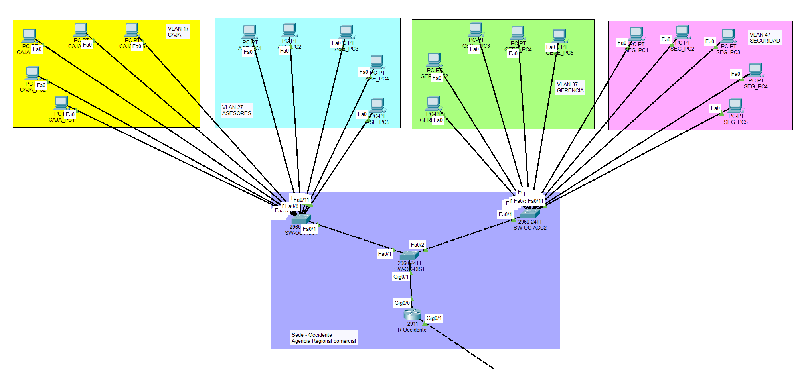
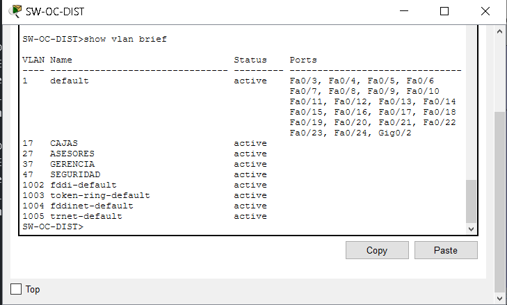
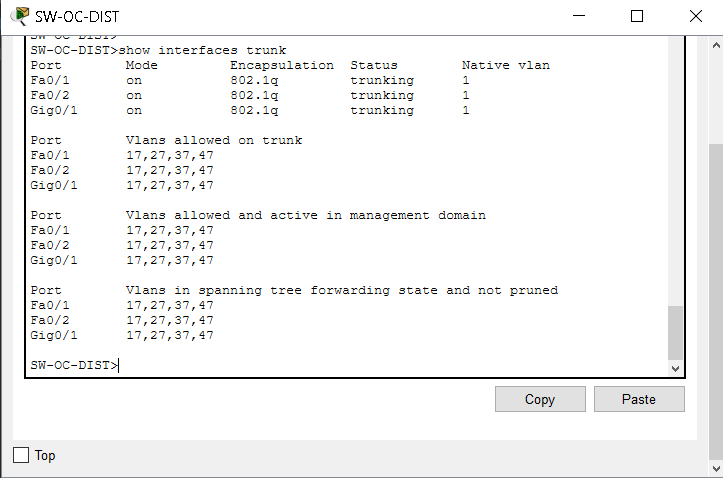
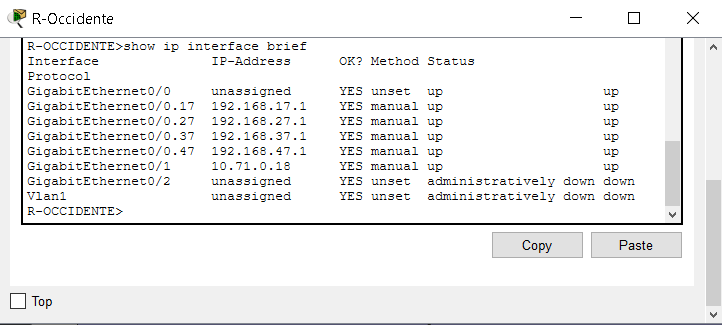
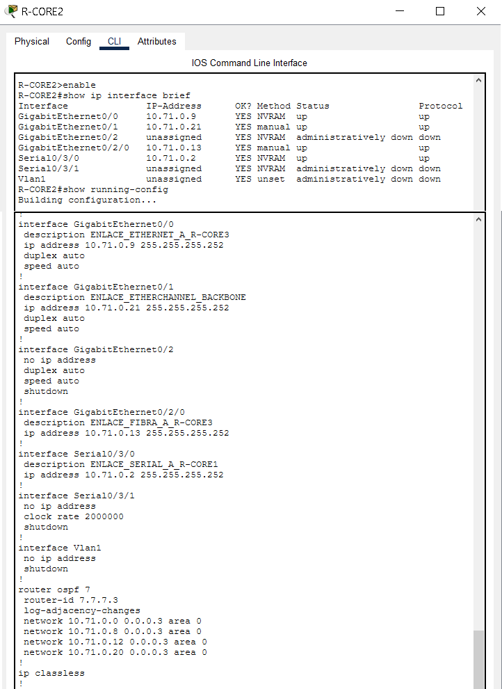
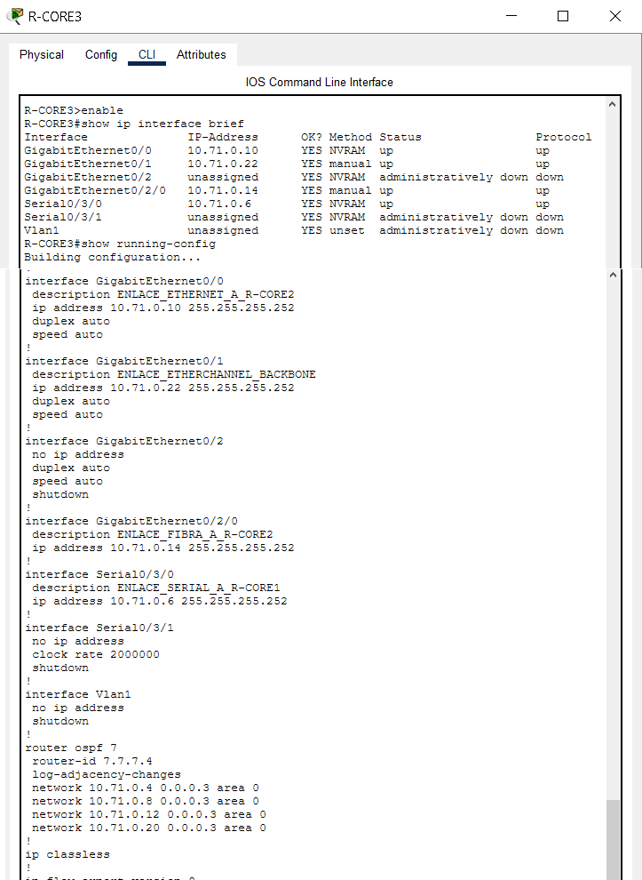
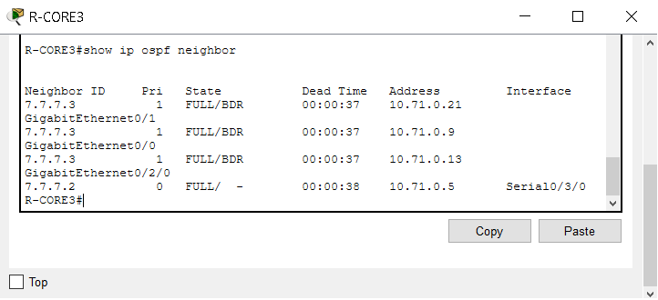
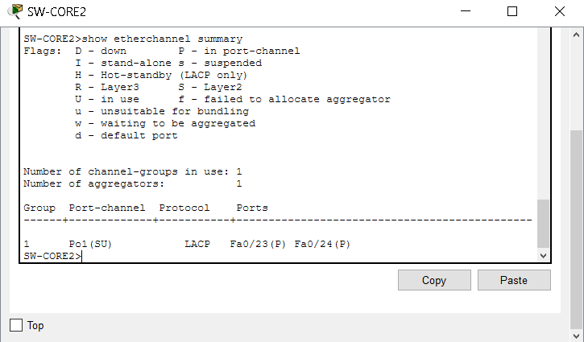

# Redes1_Proyecto2_G7

## Información general del proyecto

| **Descripción** | **Información** |
|---|---|
| **Identificador del coordinador (XX)** | 71 |
| **Identificador (Y)** | 7 |

### Integrantes del equipo

| **No.** | **Nombre completo** | **Carné** |
|---|---|---|
| 1 | Glendy Aracely De León Cajero | 202102379 |
| 2 | | |
| 3 | | |

## 1. Introducción

El presente proyecto, denominado **BanTech GT**, consistió en el diseño, implementación y configuración de una infraestructura de red multisede para una entidad financiera, desarrollado como parte del curso de Redes de Computadoras 1. Su propósito fue aplicar los conocimientos adquiridos sobre diseño de redes, direccionamiento IP, segmentación mediante VLANs, enrutamiento dinámico y estático, así como mecanismos de redundancia y alta disponibilidad, utilizando el simulador Cisco Packet Tracer.

La infraestructura se organizó en diferentes áreas operativas, conformadas por la **Sede Occidente, Sede Norte, Sede Oriente, Data Center y Sede Central**, interconectadas mediante un Backbone Core encargado de facilitar la comunicación entre las distintas redes. Cada sede presentó necesidades específicas relacionadas con la administración del tráfico, la seguridad, la disponibilidad de los servicios y la continuidad de las operaciones, por lo que se contemplaron diferentes diseños de topología y tecnologías de red de acuerdo con sus requerimientos.

Para la segmentación de las áreas funcionales se utilizaron redes de área local virtuales (VLANs), permitiendo organizar los dispositivos según su departamento y reducir el tráfico de difusión. Asimismo, se contemplaron mecanismos de enrutamiento inter-VLAN mediante Router-on-a-Stick y dispositivos multicapa, con el objetivo de establecer comunicación entre los diferentes segmentos de red.

En cuanto a la comunicación entre sedes, el proyecto contempló la implementación de los protocolos de enrutamiento **OSPF, EIGRP y RIPv2**, además de rutas estáticas y mecanismos de redistribución de rutas. Estas tecnologías permitieron diseñar una infraestructura capaz de intercambiar información entre diferentes dominios de enrutamiento y proporcionar rutas alternativas para mantener la conectividad ante posibles fallas.

De igual manera, se incorporaron mecanismos de alta disponibilidad como **EtherChannel mediante LACP, Rapid PVST+ y HSRP o VRRP**, orientados a mejorar la continuidad de la comunicación, administrar enlaces redundantes y reducir el impacto de fallas en dispositivos o conexiones críticas. La selección de estas tecnologías respondió a las necesidades operativas de cada sede y a los requerimientos establecidos en la guía del proyecto.

El desarrollo del proyecto se distribuyó entre tres integrantes, quienes asumieron responsabilidades específicas relacionadas con el diseño de las sedes, la configuración de dispositivos, la implementación de protocolos y la integración de la infraestructura. Esta organización permitió trabajar de manera coordinada y establecer una estructura común para la configuración y documentación de la red.


## 2. Identificación y criterios de diseño

Para el desarrollo del proyecto BanTech GT se utilizaron los valores **XX = 71** y **Y = 7**. Estos valores permitieron definir la numeración de las VLANs y los parámetros de identificación de la infraestructura.

### 2.1. Identificadores del proyecto

| Parámetro | Valor | Aplicación |
|---|---|---|
| Grupo | 7 | Identificación del equipo |
| Identificador XX | 71 | Últimos dos dígitos del carné del coordinador |
| Identificador Y | 7 | Numeración de VLANs |
| Dominio VTP | bantech71 | Administración centralizada de VLANs |
| Contraseña VTP requerida | cisco | Autenticación del dominio VTP |

### 2.2. Distribución de VLANs por sede

| Sede | Área funcional | ID de VLAN | Hosts requeridos | Host utilizados |
|---|---|---|---|---|
| Occidente | Cajas | 17 | 45 |5 |
| Occidente | Asesores | 27 | 30 | 5 |
| Occidente | Gerencia | 37 | 10 | 5 |
| Occidente | Seguridad | 47 | 12 | 5 |
| Norte | Análisis | 57 | 50 |  |
| Norte | Auditoría | 67 | 25 |  |
| Norte | Legal | 77 | 14 |  |
| Oriente | Bóveda | 87 | 40 |  |
| Oriente | Plataforma | 97 | 60 | |
| Data Center | Core_BD | 18 | 14 | |
| Data Center | Web_Apps | 28 | 28 | |
| Data Center | NOC | 38 | 10 | |
| **TOTAL** | **12 áreas funcionales** | **12 VLANs** | **348 hosts** |**20 hosts utilizados**|


## 3. Topología completa


# 4. Sede Occidente

### 4.1. Contexto y necesidad operativa

La Sede Occidente representó una agencia regional comercial con operaciones de cajas, atención de asesores, administración de gerencia y servicios de seguridad. Debido a que el área de cajas realiza transacciones críticas, la red se segmentó para separar los distintos departamentos y reducir el alcance del tráfico de difusión. La administración centralizada de VLANs permitió mantener una estructura ordenada entre los switches de distribución y acceso.

### 4.2. Justificación de la topología física y lógica

Se utilizó una topología jerárquica de tipo estrella, con **SW-OC-DIST** como switch de distribución y **SW-OC-ACC1** y **SW-OC-ACC2** como switches de acceso. Esta estructura facilitó la identificación de conexiones, la distribución de equipos por departamentos y el mantenimiento de la red. El router **R-OCCIDENTE** concentró el enrutamiento inter-VLAN mediante subinterfaces 802.1Q. La segmentación por VLANs aisló los dominios de broadcast, sin embargo, la topología de Occidente no incorporó redundancia física en sus enlaces de acceso, por lo que una falla en el switch de distribución podría interrumpir la conectividad de sus switches dependientes.

**Topología de Occidente:**



### 4.3. Inventario de dispositivos

| Dispositivo | Función |
|---|---|
| R-OCCIDENTE | Router de borde y Router-on-a-Stick |
| SW-OC-DIST | Switch principal de distribución; servidor VTP |
| SW-OC-ACC1 | Switch de acceso para CAJAS y ASESORES; cliente VTP |
| SW-OC-ACC2 | Switch de acceso para GERENCIA y SEGURIDAD; cliente VTP |
| 20 PCs | Cinco equipos finales por cada una de las cuatro áreas |

### 4.4. Tabla de VLANs y direccionamiento

| VLAN | Nombre | Área | Red configurada | Gateway | PCs configuradas | Capacidad requerida en la guía |
|---|---|---|---|---|---|---|
| 17 | CAJAS | Transacciones críticas | 192.168.17.0/24 | 192.168.17.1 | 192.168.17.11–15 | 45 hosts |
| 27 | ASESORES | Servicio al cliente | 192.168.27.0/24 | 192.168.27.1 | 192.168.27.11–15 | 30 hosts |
| 37 | GERENCIA | Administración local | 192.168.37.0/24 | 192.168.37.1 | 192.168.37.11–15 | 10 hosts |
| 47 | SEGURIDAD | Cámaras y biométricos | 192.168.47.0/24 | 192.168.47.1 | 192.168.47.11–15 | 12 hosts |

Las cuatro redes utilizaron máscara **255.255.255.0 (/24)**. Cada subred permite 254 direcciones de host utilizables, por lo que su capacidad supera las necesidades indicadas en el proyecto. Se utilizó un esquema uniforme de máscara fija para simplificar la administración y la identificación de las redes; no constituye un esquema optimizado mediante VLSM.

### 4.5. Configuración de VLANs, VTP y puertos

Se configuró el dominio VTP **bantech71** en los switches de Occidente, con **SW-OC-DIST** como servidor y los dos switches de acceso como clientes. Se utilizaron las VLANs 17, 27, 37 y 47. La contraseña **cisco**

| Switch | Interfaces | Uso |
|---|---|---|
| SW-OC-DIST | G0/1 | Trunk hacia R-OCCIDENTE G0/0 |
| SW-OC-DIST | Fa0/1 | Trunk hacia SW-OC-ACC1 Fa0/1 |
| SW-OC-DIST | Fa0/2 | Trunk hacia SW-OC-ACC2 Fa0/1 |
| SW-OC-ACC1 | Fa0/2–Fa0/6 | Access VLAN 17 — CAJAS |
| SW-OC-ACC1 | Fa0/7–Fa0/11 | Access VLAN 27 — ASESORES |
| SW-OC-ACC2 | Fa0/2–Fa0/6 | Access VLAN 37 — GERENCIA |
| SW-OC-ACC2 | Fa0/7–Fa0/11 | Access VLAN 47 — SEGURIDAD |

**Evidencias:**
#### VLANs Sede Occidente

```cmd
! SW-OC-DIST
show vlan brief
```



#### Enlaces troncales

```cmd
! SW-OC-DIST
show interfaces trunk
```




#### VTP 

```cmd
! SW-OC-DIST | SW-OC-ACC1 y ACC2
show vtp status
```

**como servidor**


**como cliente**


### 4.6. Enrutamiento inter-VLAN mediante Router-on-a-Stick

En **R-OCCIDENTE** se configuraron cuatro subinterfaces sobre **GigabitEthernet0/0**, una por VLAN, utilizando encapsulación 802.1Q. Cada subinterfaz se estableció como puerta de enlace de su departamento.

```cmd
!R-OCCIDENTE
show ip interface brief
```

**Evidencia:**



### 4.7. Pruebas de conectividad de Occidente

Se verificó la comunicación dentro de cada VLAN mediante pruebas de ping entre equipos del mismo departamento. También se comprobó la comunicación desde equipos finales hacia sus respectivas puertas de enlace y entre las VLANs de CAJAS, ASESORES, GERENCIA y SEGURIDAD. Las pruebas reportadas finalizaron con **0 % de pérdida de paquetes**.

| Origen | Destino | Prueba realizada | Resultado |
|---|---|---|---|
| CAJAS PC1 | CAJAS PC2 | 192.168.17.12 | Exitosa |
| ASESORES PC1 | ASESORES PC2 | 192.168.27.12 | Exitosa |
| GERENCIA PC1 | GERENCIA PC2 | 192.168.37.12 | Exitosa |
| SEGURIDAD PC1 | SEGURIDAD PC2 | 192.168.47.12 | Exitosa |
| CAJAS PC1 | ASESORES PC1 | 192.168.27.11 | Exitosa |
| CAJAS PC1 | GERENCIA PC1 | 192.168.37.11 | Exitosa |
| CAJAS PC1 | SEGURIDAD PC1 | 192.168.47.11 | Exitosa |

```cmd
!R-OCCIDENTE
show running-config
```

**Evidencias:**


## 5. Backbone Core y OSPF

### 5.1. Justificación de la arquitectura del Backbone

Se implementó un núcleo de tres routers Cisco 2911, denominados **R-CORE1**, **R-CORE2** y **R-CORE3**, con enlaces que conformaron una estructura triangular. Esta distribución proporcionó caminos alternativos para el enrutamiento entre routers. Entre R-CORE2 y R-CORE3 se utilizaron enlaces Ethernet, fibra óptica y un enlace adicional transportado por switches con EtherChannel LACP. El uso de OSPF permitió aprender las redes conectadas y recalcular rutas cuando se desactivó temporalmente una conexión serial.

**Topología del Backbone:**


### 5.2. Inventario de dispositivos del núcleo

| Dispositivo | Modelo | Función |
|---|---|---|
| R-CORE1 | Cisco 2911 | Núcleo y conexión a R-OCCIDENTE |
| R-CORE2 | Cisco 2911 | Núcleo y enlaces redundantes a R-CORE3 |
| R-CORE3 | Cisco 2911 | Núcleo y enlaces redundantes a R-CORE2 |
| SW-CORE2 | Cisco 2960 | Extremo izquierdo del EtherChannel LACP |
| SW-CORE3 | Cisco 2960 | Extremo derecho del EtherChannel LACP |

### 5.3. Tabla de subneteo y enlaces del Backbone

Se asignaron seis subredes **/30 (255.255.255.252)**, cada una con dos direcciones de host utilizables, para las conexiones punto a punto.

| Red | Primer extremo | Segundo extremo | Medio |
|---|---|---|---|
| 10.71.0.0/30 | R-CORE1 S0/3/0: 10.71.0.1 | R-CORE2 S0/3/0: 10.71.0.2 | Serial |
| 10.71.0.4/30 | R-CORE1 S0/3/1: 10.71.0.5 | R-CORE3 S0/3/0: 10.71.0.6 | Serial |
| 10.71.0.8/30 | R-CORE2 G0/0: 10.71.0.9 | R-CORE3 G0/0: 10.71.0.10 | Ethernet |
| 10.71.0.12/30 | R-CORE2 G0/2/0: 10.71.0.13 | R-CORE3 G0/2/0: 10.71.0.14 | Fibra óptica |
| 10.71.0.16/30 | R-CORE1 G0/0: 10.71.0.17 | R-OCCIDENTE G0/1: 10.71.0.18 | Ethernet |
| 10.71.0.20/30 | R-CORE2 G0/1: 10.71.0.21 | R-CORE3 G0/1: 10.71.0.22 | A través de switches y EtherChannel |

**Evidencias:**

```cmd
!R-CORE1 | R-CORE2   |   R_CORE3
show ip interface brief
show running-config
```







### 5.4. Configuración y verificación de OSPF

Se configuró el protocolo OSPF mediante el proceso 7 y el área 0 para permitir el intercambio de rutas entre la Sede Occidente y los tres routers del Backbone Core.

| Router | Router ID |
|---|---|
| R-OCCIDENTE | 7.7.7.1 |
| R-CORE1 | 7.7.7.2 |
| R-CORE2 | 7.7.7.3 |
| R-CORE3 | 7.7.7.4 |

En R-OCCIDENTE se anunciaron las cuatro redes departamentales y el enlace hacia el núcleo. Se configuraron las subinterfaces de usuario como pasivas para evitar establecer vecinos OSPF con los dispositivos finales.

**Evidencia**

```cmd
show ip ospf neighbor
```

El resultado mostró cuatro adyacencias en estado FULL: una hacia R-CORE1 y tres hacia R-CORE2, correspondientes a los enlaces Ethernet, fibra óptica y EtherChannel.

**Evidencia — Vecinos OSPF:**



### 5.5. Configuración y verificación de EtherChannel LACP

Se implementó EtherChannel mediante LACP entre los switches SW-CORE2 y SW-CORE3, utilizando las interfaces FastEthernet0/23 y FastEthernet0/24. Ambos enlaces se agruparon en Port-channel 1.

Se configuró la VLAN 71, denominada BACKBONE_CORE, para transportar la comunicación entre R-CORE2 y R-CORE3 mediante el enlace agregado.

| Elemento | Configuración |
|---|---|
| Switches | SW-CORE2 y SW-CORE3 |
| Protocolo | LACP |
| Grupo | Port-channel 1 |
| Interfaces | Fa0/23 y Fa0/24 |
| VLAN | 71 — BACKBONE_CORE |
| Red de comunicación | 10.71.0.20/30 |
| Dirección de R-CORE2 | 10.71.0.21 |
| Dirección de R-CORE3 | 10.71.0.22 |

### 5.6. Prueba de tolerancia a fallos de EtherChannel

Se realizó una prueba controlada desactivando temporalmente FastEthernet0/23 en SW-CORE2, manteniendo activa FastEthernet0/24.

Desde R-CORE2 se ejecutó una prueba de conectividad hacia la dirección 10.71.0.22, correspondiente a R-CORE3.

El resultado fue exitoso, con cinco paquetes enviados y cinco recibidos, equivalente al 100 % de conectividad y 0 % de pérdida de paquetes.

Después se restauró FastEthernet0/23 y se comprobó que ambos enlaces regresaron correctamente al Port-channel 1.

| Prueba | Resultado |
|---|---|
| Estado final de EtherChannel | Po1(SU) |


```cmd
show etherchannel summary
```

**Evidencia - EtherChannel LACP:**

