# Redes1_Proyecto2_G7

## Información general del proyecto

| **Descripción** | **Información** |
|---|---|
| **Identificador del coordinador (XX)** | 71 |
| **Identificador (Y)** | 7 |

### Integrantes del equipo

| **No.** | **Nombre completo** | **Carnet** |
|---|---|---|
| 1 | Glendy Aracely De León Cajero | 202102379 |
| 2 | Mayelin Lucía Quevedo Camey | 202307771 |
| 3 | Emily Maritza Tepeu Guacamaya | 202402955 |

## 1. Introducción

El presente proyecto, denominado **BanTech GT**, consistió en el diseño, implementación y configuración de una infraestructura de red multisede para una entidad financiera, desarrollado como parte del curso de Redes de Computadoras 1. Su propósito fue aplicar los conocimientos adquiridos sobre diseño de redes, direccionamiento IP, segmentación mediante VLANs, enrutamiento dinámico y estático, así como mecanismos de redundancia y alta disponibilidad, utilizando el simulador Cisco Packet Tracer.

La infraestructura se organizó en diferentes áreas operativas, conformadas por la **Sede Occidente, Sede Norte, Sede Oriente, Data Center y Sede Central**, interconectadas mediante un Backbone Core encargado de facilitar la comunicación entre las distintas redes. Cada sede presentó necesidades específicas relacionadas con la administración del tráfico, la seguridad, la disponibilidad de los servicios y la continuidad de las operaciones, por lo que se contemplaron diferentes diseños de topología y tecnologías de red de acuerdo con sus requerimientos.

Para la segmentación de las áreas funcionales se utilizaron redes de área local virtuales (VLANs), permitiendo organizar los dispositivos según su departamento y reducir el tráfico de difusión. Asimismo, se contemplaron mecanismos de enrutamiento inter-VLAN mediante Router-on-a-Stick y dispositivos multicapa, con el objetivo de establecer comunicación entre los diferentes segmentos de red.

En cuanto a la comunicación entre sedes, el proyecto contempló la implementación de los protocolos de enrutamiento **OSPF, EIGRP y RIPv2**, además de rutas estáticas y mecanismos de redistribución de rutas. Estas tecnologías permitieron diseñar una infraestructura capaz de intercambiar información entre diferentes dominios de enrutamiento y proporcionar rutas alternativas para mantener la conectividad ante posibles fallas.

De igual manera, se incorporaron mecanismos de alta disponibilidad como **EtherChannel mediante LACP, Rapid PVST+ y HSRP o VRRP**, orientados a mejorar la continuidad de la comunicación, administrar enlaces redundantes y reducir el impacto de fallas en dispositivos o conexiones críticas. La selección de estas tecnologías respondió a las necesidades operativas de cada sede y a los requerimientos establecidos en la guía del proyecto.

El desarrollo del proyecto se distribuyó entre tres integrantes, quienes asumieron responsabilidades específicas relacionadas con el diseño de las sedes, la configuración de dispositivos, la implementación de protocolos y la integración de la infraestructura. Esta organización permitió trabajar de manera coordinada y establecer una estructura común para la configuración y documentación de la red.


## 2. Identificación y criterios de diseño

Para el desarrollo del proyecto BanTech GT se utilizaron los valores **XX = 71** y **Y = 7**. Estos valores permitieron definir la numeración de las VLANs y los parámetros de identificación de la infraestructura.

### 2.1. Identificadores del proyecto

| Parámetro | Valor | Aplicación |
|---|---|---|
| Grupo | 7 | Identificación del equipo |
| Identificador XX | 71 | Últimos dos dígitos del carné del coordinador |
| Identificador Y | 7 | Numeración de VLANs |
| Dominio VTP | bantech71 | Administración centralizada de VLANs |
| Contraseña VTP requerida | cisco | Autenticación del dominio VTP |

### 2.2. Distribución de VLANs por sede

| Sede | Área funcional | ID de VLAN | Hosts requeridos | Host utilizados |
|---|---|---|---|---|
| Occidente | Cajas | 17 | 45 |5 |
| Occidente | Asesores | 27 | 30 | 5 |
| Occidente | Gerencia | 37 | 10 | 5 |
| Occidente | Seguridad | 47 | 12 | 5 |
| Norte | Análisis | 57 | 50 |  |
| Norte | Auditoría | 67 | 25 |  |
| Norte | Legal | 77 | 14 |  |
| Oriente | Bóveda | 87 | 40 |  |
| Oriente | Plataforma | 97 | 60 | |
| Data Center | Core_BD | 18 | 14 | |
| Data Center | Web_Apps | 28 | 28 | |
| Data Center | NOC | 38 | 10 | |
| **TOTAL** | **12 áreas funcionales** | **12 VLANs** | **348 hosts** |**20 hosts utilizados**|


## 3. Topología completa

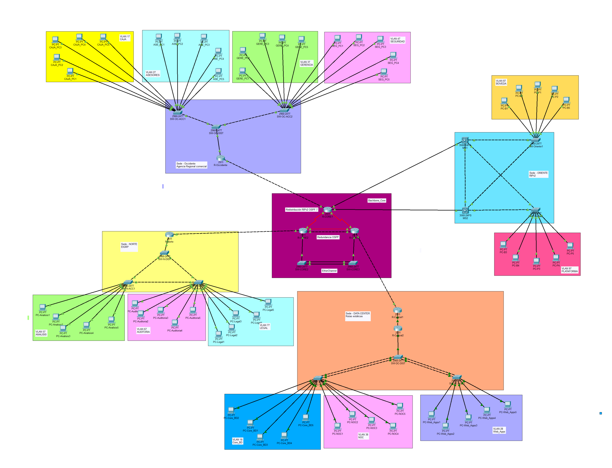

# 4. Sede Occidente

### 4.1. Contexto y necesidad operativa

La Sede Occidente representó una agencia regional comercial con operaciones de cajas, atención de asesores, administración de gerencia y servicios de seguridad. Debido a que el área de cajas realiza transacciones críticas, la red se segmentó para separar los distintos departamentos y reducir el alcance del tráfico de difusión. La administración centralizada de VLANs permitió mantener una estructura ordenada entre los switches de distribución y acceso.

### 4.2. Justificación de la topología física y lógica

Se utilizó una topología jerárquica de tipo estrella, con **SW-OC-DIST** como switch de distribución y **SW-OC-ACC1** y **SW-OC-ACC2** como switches de acceso. Esta estructura facilitó la identificación de conexiones, la distribución de equipos por departamentos y el mantenimiento de la red. El router **R-OCCIDENTE** concentró el enrutamiento inter-VLAN mediante subinterfaces 802.1Q. La segmentación por VLANs aisló los dominios de broadcast, sin embargo, la topología de Occidente no incorporó redundancia física en sus enlaces de acceso, por lo que una falla en el switch de distribución podría interrumpir la conectividad de sus switches dependientes.

**Topología de Occidente:**


### 4.3. Inventario de dispositivos

| Dispositivo | Función |
|---|---|
| R-OCCIDENTE | Router de borde y Router-on-a-Stick |
| SW-OC-DIST | Switch principal de distribución; servidor VTP |
| SW-OC-ACC1 | Switch de acceso para CAJAS y ASESORES; cliente VTP |
| SW-OC-ACC2 | Switch de acceso para GERENCIA y SEGURIDAD; cliente VTP |
| 20 PCs | Cinco equipos finales por cada una de las cuatro áreas |

### 4.4. Tabla de VLANs y direccionamiento

| VLAN | Nombre | Área | Red configurada | Gateway | PCs configuradas | Capacidad requerida en la guía |
|---|---|---|---|---|---|---|
| 17 | CAJAS | Transacciones críticas | 192.168.17.0/24 | 192.168.17.1 | 192.168.17.11–15 | 45 hosts |
| 27 | ASESORES | Servicio al cliente | 192.168.27.0/24 | 192.168.27.1 | 192.168.27.11–15 | 30 hosts |
| 37 | GERENCIA | Administración local | 192.168.37.0/24 | 192.168.37.1 | 192.168.37.11–15 | 10 hosts |
| 47 | SEGURIDAD | Cámaras y biométricos | 192.168.47.0/24 | 192.168.47.1 | 192.168.47.11–15 | 12 hosts |

Las cuatro redes utilizaron máscara **255.255.255.0 (/24)**. Cada subred permite 254 direcciones de host utilizables, por lo que su capacidad supera las necesidades indicadas en el proyecto. Se utilizó un esquema uniforme de máscara fija para simplificar la administración y la identificación de las redes; no constituye un esquema optimizado mediante VLSM.

### 4.5. Configuración de VLANs, VTP y puertos

Se configuró el dominio VTP **bantech71** en los switches de Occidente, con **SW-OC-DIST** como servidor y los dos switches de acceso como clientes. Se utilizaron las VLANs 17, 27, 37 y 47. La contraseña **cisco**

| Switch | Interfaces | Uso |
|---|---|---|
| SW-OC-DIST | G0/1 | Trunk hacia R-OCCIDENTE G0/0 |
| SW-OC-DIST | Fa0/1 | Trunk hacia SW-OC-ACC1 Fa0/1 |
| SW-OC-DIST | Fa0/2 | Trunk hacia SW-OC-ACC2 Fa0/1 |
| SW-OC-ACC1 | Fa0/2–Fa0/6 | Access VLAN 17 — CAJAS |
| SW-OC-ACC1 | Fa0/7–Fa0/11 | Access VLAN 27 — ASESORES |
| SW-OC-ACC2 | Fa0/2–Fa0/6 | Access VLAN 37 — GERENCIA |
| SW-OC-ACC2 | Fa0/7–Fa0/11 | Access VLAN 47 — SEGURIDAD |

**Evidencias:**
#### VLANs Sede Occidente

```cmd
! SW-OC-DIST
show vlan brief
```


#### Enlaces troncales

```cmd
! SW-OC-DIST
show interfaces trunk
```


#### VTP 

```cmd
! SW-OC-DIST | SW-OC-ACC1 y ACC2
show vtp status
```

**como servidor**

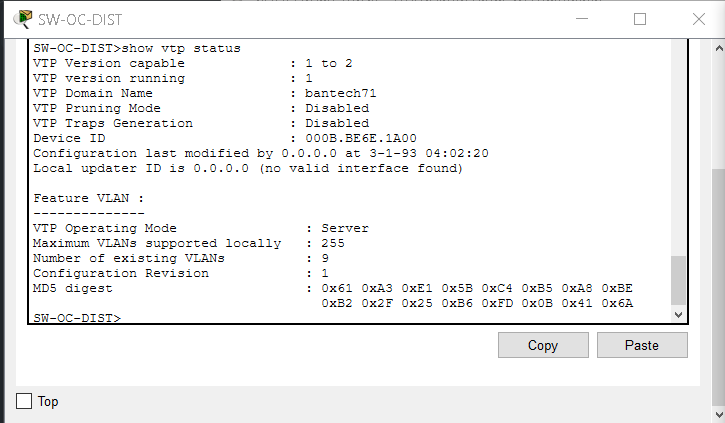

**como cliente**

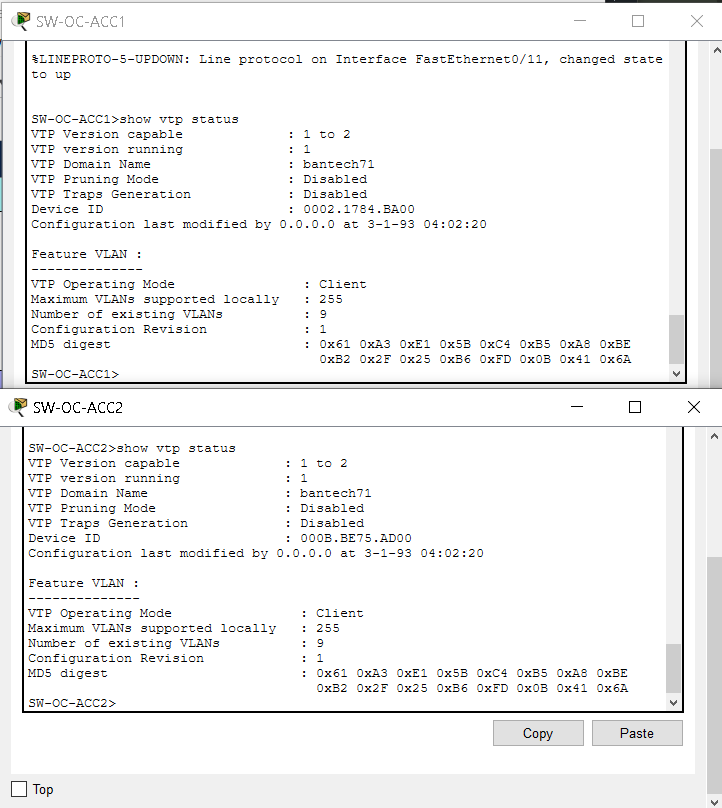


### 4.6. Enrutamiento inter-VLAN mediante Router-on-a-Stick

En **R-OCCIDENTE** se configuraron cuatro subinterfaces sobre **GigabitEthernet0/0**, una por VLAN, utilizando encapsulación 802.1Q. Cada subinterfaz se estableció como puerta de enlace de su departamento.

```cmd
!R-OCCIDENTE
show ip interface brief
```

**Evidencia:**


### 4.7. Pruebas de conectividad de Occidente

Se verificó la comunicación dentro de cada VLAN mediante pruebas de ping entre equipos del mismo departamento. También se comprobó la comunicación desde equipos finales hacia sus respectivas puertas de enlace y entre las VLANs de CAJAS, ASESORES, GERENCIA y SEGURIDAD. Las pruebas reportadas finalizaron con **0 % de pérdida de paquetes**.

| Origen | Destino | Prueba realizada | Resultado |
|---|---|---|---|
| CAJAS PC1 | CAJAS PC2 | 192.168.17.12 | Exitosa |
| ASESORES PC1 | ASESORES PC2 | 192.168.27.12 | Exitosa |
| GERENCIA PC1 | GERENCIA PC2 | 192.168.37.12 | Exitosa |
| SEGURIDAD PC1 | SEGURIDAD PC2 | 192.168.47.12 | Exitosa |
| CAJAS PC1 | ASESORES PC1 | 192.168.27.11 | Exitosa |
| CAJAS PC1 | GERENCIA PC1 | 192.168.37.11 | Exitosa |
| CAJAS PC1 | SEGURIDAD PC1 | 192.168.47.11 | Exitosa |

```cmd
!R-OCCIDENTE
show running-config
```

**Evidencias:**

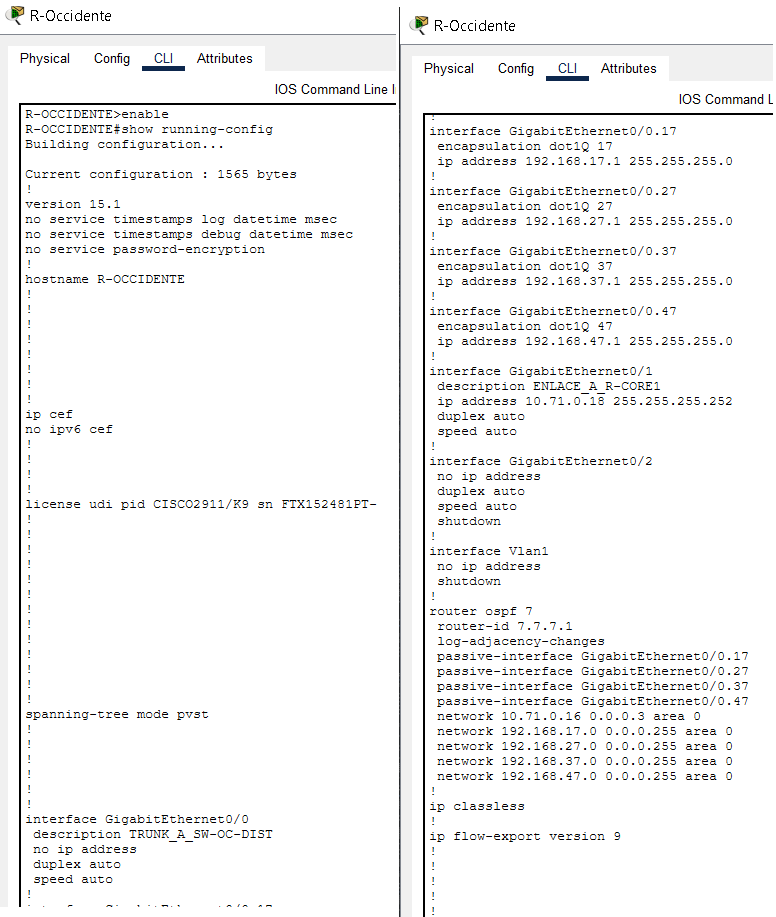

## 5. Backbone Core y OSPF

### 5.1. Justificación de la arquitectura del Backbone

Se implementó un núcleo de tres routers Cisco 2911, denominados **R-CORE1**, **R-CORE2** y **R-CORE3**, con enlaces que conformaron una estructura triangular. Esta distribución proporcionó caminos alternativos para el enrutamiento entre routers. Entre R-CORE2 y R-CORE3 se utilizaron enlaces Ethernet, fibra óptica y un enlace adicional transportado por switches con EtherChannel LACP. El uso de OSPF permitió aprender las redes conectadas y recalcular rutas cuando se desactivó temporalmente una conexión serial.

**Topología del Backbone:**

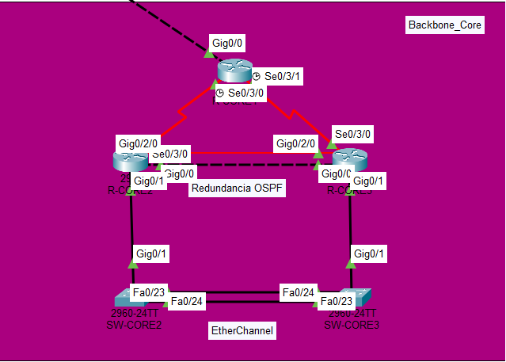

### 5.2. Inventario de dispositivos del núcleo

| Dispositivo | Modelo | Función |
|---|---|---|
| R-CORE1 | Cisco 2911 | Núcleo y conexión a R-OCCIDENTE |
| R-CORE2 | Cisco 2911 | Núcleo y enlaces redundantes a R-CORE3 |
| R-CORE3 | Cisco 2911 | Núcleo y enlaces redundantes a R-CORE2 |
| SW-CORE2 | Cisco 2960 | Extremo izquierdo del EtherChannel LACP |
| SW-CORE3 | Cisco 2960 | Extremo derecho del EtherChannel LACP |

### 5.3. Tabla de subneteo y enlaces del Backbone

Se asignaron seis subredes **/30 (255.255.255.252)**, cada una con dos direcciones de host utilizables, para las conexiones punto a punto.

| Red | Primer extremo | Segundo extremo | Medio |
|---|---|---|---|
| 10.71.0.0/30 | R-CORE1 S0/3/0: 10.71.0.1 | R-CORE2 S0/3/0: 10.71.0.2 | Serial |
| 10.71.0.4/30 | R-CORE1 S0/3/1: 10.71.0.5 | R-CORE3 S0/3/0: 10.71.0.6 | Serial |
| 10.71.0.8/30 | R-CORE2 G0/0: 10.71.0.9 | R-CORE3 G0/0: 10.71.0.10 | Ethernet |
| 10.71.0.12/30 | R-CORE2 G0/2/0: 10.71.0.13 | R-CORE3 G0/2/0: 10.71.0.14 | Fibra óptica |
| 10.71.0.16/30 | R-CORE1 G0/0: 10.71.0.17 | R-OCCIDENTE G0/1: 10.71.0.18 | Ethernet |
| 10.71.0.20/30 | R-CORE2 G0/1: 10.71.0.21 | R-CORE3 G0/1: 10.71.0.22 | A través de switches y EtherChannel |

**Evidencias:**

```cmd
!R-CORE1 | R-CORE2   |   R_CORE3
show ip interface brief
show running-config
```

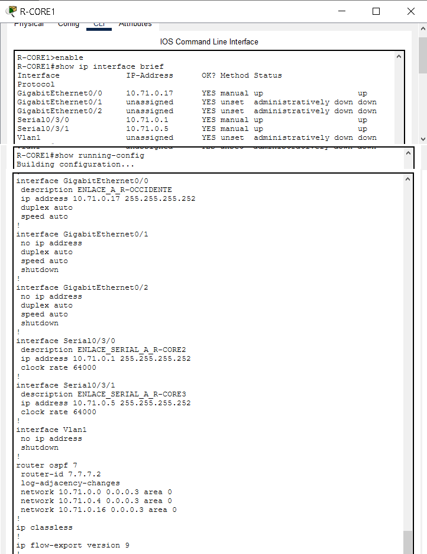


### 5.4. Configuración y verificación de OSPF

Se configuró el protocolo OSPF mediante el proceso 7 y el área 0 para permitir el intercambio de rutas entre la Sede Occidente y los tres routers del Backbone Core.

| Router | Router ID |
|---|---|
| R-OCCIDENTE | 7.7.7.1 |
| R-CORE1 | 7.7.7.2 |
| R-CORE2 | 7.7.7.3 |
| R-CORE3 | 7.7.7.4 |

En R-OCCIDENTE se anunciaron las cuatro redes departamentales y el enlace hacia el núcleo. Se configuraron las subinterfaces de usuario como pasivas para evitar establecer vecinos OSPF con los dispositivos finales.

**Evidencia**

```cmd
show ip ospf neighbor
```

El resultado mostró cuatro adyacencias en estado FULL: una hacia R-CORE1 y tres hacia R-CORE2, correspondientes a los enlaces Ethernet, fibra óptica y EtherChannel.

**Evidencia — Vecinos OSPF:**


### 5.5. Configuración y verificación de EtherChannel LACP

Se implementó EtherChannel mediante LACP entre los switches SW-CORE2 y SW-CORE3, utilizando las interfaces FastEthernet0/23 y FastEthernet0/24. Ambos enlaces se agruparon en Port-channel 1.

Se configuró la VLAN 71, denominada BACKBONE_CORE, para transportar la comunicación entre R-CORE2 y R-CORE3 mediante el enlace agregado.

| Elemento | Configuración |
|---|---|
| Switches | SW-CORE2 y SW-CORE3 |
| Protocolo | LACP |
| Grupo | Port-channel 1 |
| Interfaces | Fa0/23 y Fa0/24 |
| VLAN | 71 — BACKBONE_CORE |
| Red de comunicación | 10.71.0.20/30 |
| Dirección de R-CORE2 | 10.71.0.21 |
| Dirección de R-CORE3 | 10.71.0.22 |

### 5.6. Prueba de tolerancia a fallos de EtherChannel

Se realizó una prueba controlada desactivando temporalmente FastEthernet0/23 en SW-CORE2, manteniendo activa FastEthernet0/24.

Desde R-CORE2 se ejecutó una prueba de conectividad hacia la dirección 10.71.0.22, correspondiente a R-CORE3.

El resultado fue exitoso, con cinco paquetes enviados y cinco recibidos, equivalente al 100 % de conectividad y 0 % de pérdida de paquetes.

Después se restauró FastEthernet0/23 y se comprobó que ambos enlaces regresaron correctamente al Port-channel 1.

| Prueba | Resultado |
|---|---|
| Estado final de EtherChannel | Po1(SU) |


```cmd
show etherchannel summary
```

**Evidencia - EtherChannel LACP:**


# BanTech GT: Sede Norte y Data Center 


| Sede | Dominio de enrutamiento | Equipos | Dispositivos finales |
|---|---|---|---|
| Norte (Centro de Autorización de Créditos) | EIGRP AS 7 | R-Norte, SW-N-DIST, SW-N-ACC1, SW-N-ACC2 | 15 PCs (5 por VLAN) |
| Data Center y Sede Central | Rutas estáticas (redistribuidas a OSPF) | R-Central1, R-Central2, SW-DC-DIST, SW-DC-ACC1, SW-DC-ACC2 | 15 servidores (5 por VLAN) |

Tecnologías aplicadas: VLANs con nombre, trunks 802.1Q, VTP, router-on-a-stick, Rapid PVST+ con Root Bridge forzado, EtherChannel LACP, EIGRP, rutas estáticas y redistribución.

---

## 6. Sede Norte

### 6.1 Topología

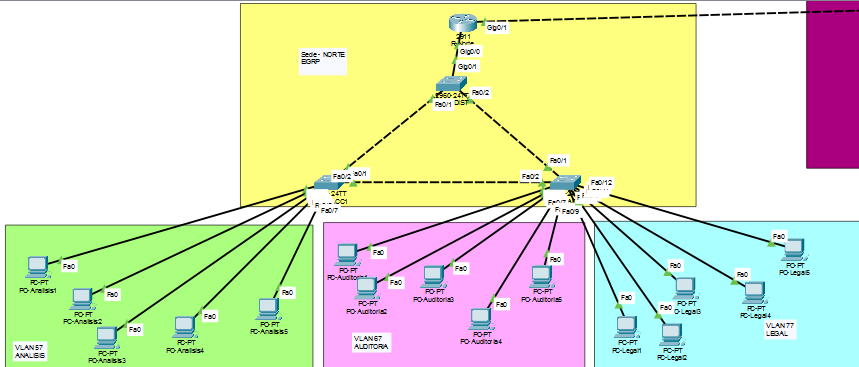

### 6.2 Justificación de arquitectura

**Topología física.** Se diseñó un triángulo de tres switches (`SW-N-DIST`, `SW-N-ACC1` y `SW-N-ACC2`) con trunks 802.1Q entre todos ellos. Cada switch de acceso tiene dos caminos hacia el switch principal: el enlace directo y el que pasa por el otro switch de acceso. `R-Norte` se conecta a `SW-N-DIST`, que es el centro lógico de la sede.

**Tolerancia a fallos.** Si cae cualquier enlace del triángulo, Rapid PVST+ pasa el puerto alterno a forwarding en pocos segundos y el tráfico continúa sin intervención manual. El mismo protocolo bloquea el bucle físico mientras todos los enlaces funcionan, lo que evita tormentas de broadcast.

**Respuesta a la necesidad operativa.** En esta sede se aprueban los créditos de todo el país, y una caída detiene esa operación. El requisito era que no existiera un único punto de falla de Capa 2 entre los switches de los analistas y el switch principal. El triángulo lo cumple: ningún switch de acceso depende de un solo cable.

**Elección del Root Bridge.** `SW-N-DIST` es el Root Bridge de las VLANs 57, 67 y 77 (prioridad 4096). Se eligió porque es el switch más cercano a `R-Norte`: todo el tráfico que sale de la sede pasa por él, así que el camino hacia el router es el más corto desde cualquier acceso. `SW-N-ACC1` quedó con prioridad 8192 como Root secundario, por si `SW-N-DIST` falla.

**Elección de EIGRP.** Norte es una sede regional en expansión, y EIGRP es el dominio de expansión regional que pide el backbone. Converge rápido y permite sumar subredes sin reconfigurar los demás dominios.

**Elección de router-on-a-stick.** La sede tiene un solo router y tres VLANs, con carga de tráfico moderada entre ellas. Un único enlace trunk con subinterfaces resuelve el inter-VLAN sin añadir un switch multicapa.

### 6.3 Tabla de VLANs

| VLAN | Nombre | Área funcional | Hosts requeridos | Dispositivos | Switch de acceso | Puertos |
|---|---|---|---|---|---|---|
| 57 | Analisis | Analistas de riesgo | 50 | 5 | SW-N-ACC1 | Fa0/3-7 |
| 67 | Auditoria | Revisión de cuentas | 25 | 5 | SW-N-ACC2 | Fa0/3-4, Fa0/7-9 |
| 77 | Legal | Contratos | 14 | 5 | SW-N-ACC2 | Fa0/5-6, Fa0/10-12 |

### 6.4 Subnetting (VLSM)

Bloque base: `172.16.71.0/24`. Se asignó de la subred más grande a la más pequeña.

| VLAN | Hosts req. | Máscara | Red | Primer host | Último host | Broadcast | Gateway |
|---|---|---|---|---|---|---|---|
| 57 Analisis | 50 | /26 (255.255.255.192) | 172.16.71.0 | .1 | .62 | .63 | 172.16.71.1 |
| 67 Auditoria | 25 | /27 (255.255.255.224) | 172.16.71.64 | .65 | .94 | .95 | 172.16.71.65 |
| 77 Legal | 14 | /27 (255.255.255.224) | 172.16.71.96 | .97 | .126 | .127 | 172.16.71.97 |

Legal usa /27 y no /28 porque los 14 hosts más el gateway suman 15, y un /28 solo ofrece 14 direcciones útiles.

**Enlace al backbone:** `10.71.0.24/30` (R-CORE2 `10.71.0.25` ↔ R-Norte `10.71.0.26`).

### 6.5 Direcciones asignadas

| Zona | IPs de los dispositivos | Máscara | Gateway |
|---|---|---|---|
| Analisis | 172.16.71.2 a 172.16.71.6 | 255.255.255.192 | 172.16.71.1 |
| Auditoria | 172.16.71.66 a 172.16.71.70 | 255.255.255.224 | 172.16.71.65 |
| Legal | 172.16.71.98 a 172.16.71.102 | 255.255.255.224 | 172.16.71.97 |

### 6.6 Mapeo lógico

| Dispositivo | Rol | Trunks 802.1Q | Puertos de acceso |
|---|---|---|---|
| R-Norte | Router de borde, router-on-a-stick, EIGRP | Gi0/0 (subinterfaces .57, .67, .77) | n/a |
| SW-N-DIST | Distribución, Root Bridge, VTP server | Gi0/1 (R-Norte), Fa0/1 (ACC1), Fa0/2 (ACC2) | n/a |
| SW-N-ACC1 | Acceso, Root secundario, VTP client | Fa0/1 (DIST), Fa0/2 (ACC2) | Fa0/3-7 (VLAN 57) |
| SW-N-ACC2 | Acceso, VTP client | Fa0/1 (DIST), Fa0/2 (ACC1) | Fa0/3-4 y Fa0/7-9 (VLAN 67), Fa0/5-6 y Fa0/10-12 (VLAN 77) |

### 6.7 Configuraciones principales

**R-Norte** (router-on-a-stick y EIGRP):
```
hostname R-Norte
interface GigabitEthernet0/0.57
 encapsulation dot1Q 57
 ip address 172.16.71.1 255.255.255.192
interface GigabitEthernet0/0.67
 encapsulation dot1Q 67
 ip address 172.16.71.65 255.255.255.224
interface GigabitEthernet0/0.77
 encapsulation dot1Q 77
 ip address 172.16.71.97 255.255.255.224
interface GigabitEthernet0/1
 ip address 10.71.0.26 255.255.255.252
router eigrp 7
 no auto-summary
 network 172.16.71.0 0.0.0.127
 network 10.71.0.24 0.0.0.3
 passive-interface GigabitEthernet0/0.57
 passive-interface GigabitEthernet0/0.67
 passive-interface GigabitEthernet0/0.77
```

**SW-N-DIST** (VTP server, VLANs y Root Bridge):
```
hostname SW-N-DIST
spanning-tree mode rapid-pvst
vtp mode server
vtp domain bantech71
vtp password cisco
vlan 57
 name Analisis
vlan 67
 name Auditoria
vlan 77
 name Legal
spanning-tree vlan 57,67,77 priority 4096
```

**SW-N-ACC1 y SW-N-ACC2** (VTP client y puertos de acceso, ejemplo de ACC1):
```
hostname SW-N-ACC1
spanning-tree mode rapid-pvst
vtp mode client
vtp domain bantech71
vtp password cisco
spanning-tree vlan 57,67,77 priority 8192
interface range FastEthernet0/3 - 7
 switchport mode access
 switchport access vlan 57
 spanning-tree portfast
```
(SW-N-ACC2 es igual, pero sin la línea de prioridad y con sus propios puertos y VLANs.)

**R-CORE2** (backbone, redistribución OSPF ↔ EIGRP;):
```
interface GigabitEthernet0/2
 ip address 10.71.0.25 255.255.255.252
router eigrp 7
 no auto-summary
 network 10.71.0.24 0.0.0.3
 redistribute ospf 7 metric 10000 100 255 1 1500
router ospf 7
 redistribute eigrp 7 subnets
```

### 6.8 Evidencias

**VLANs** (`show vlan brief`):

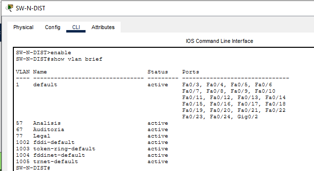

**Trunks** (`show interfaces trunk`):

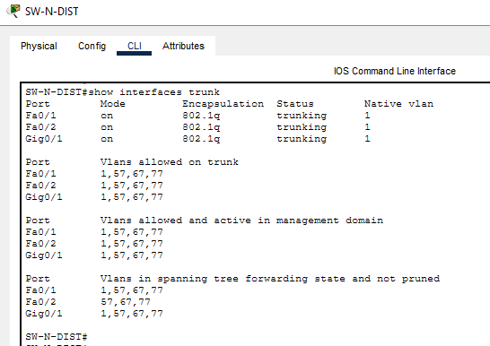


**Rapid PVST+ y Root Bridge** (`show spanning-tree summary`):

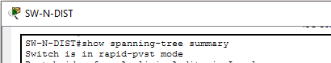
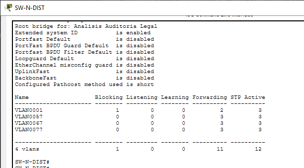


**EIGRP** (`show ip eigrp neighbors` y `show ip route`):

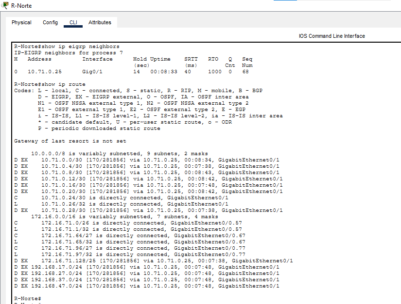

---

## 7. Data Center y Sede Central

### 7.1 Topología

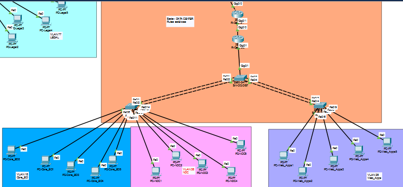

### 7.2 Justificación de arquitectura

**Topología física.** Se usó un diseño jerárquico de dos capas. `R-Central2` se conecta por un trunk a `SW-DC-DIST` (distribución), que a su vez se une con dos cables en EtherChannel a cada uno de los dos switches de acceso (`SW-DC-ACC1` y `SW-DC-ACC2`), donde se conectan los servidores. Separar distribución y acceso permite crecer agregando switches de acceso sin tocar el resto.

**Tolerancia a fallos.** Cada enlace entre distribución y acceso son dos cables agrupados en un EtherChannel. Si uno de los cables falla, el otro mantiene el enlace activo sin que STP tenga que reconverger, y los servidores no pierden conectividad.

**Respuesta a la necesidad operativa.** Los enlaces hacia las granjas de servidores manejan ráfagas masivas de tráfico, y un solo cable no tiene el ancho de banda suficiente. EtherChannel suma la capacidad de los cables del grupo y reparte el tráfico entre ellos.

**Aislamiento con rutas estáticas.** El Data Center está aislado por políticas de seguridad. `R-Central2` solo tiene una ruta por defecto hacia `R-Central1`, y no participa en ningún protocolo dinámico. `R-Central1` tiene una ruta estática hacia las redes de servidores y las redistribuye a OSPF. Así el resto de las sedes alcanza el Data Center sin que este quede expuesto directamente al núcleo, y el enlace entre `R-Central1` y `R-Central2` no se anuncia al backbone.

**Elección de LACP.** Es un estándar abierto (IEEE 802.3ad) y no depende de equipos Cisco, a diferencia de PAgP.

### 7.3 Tabla de VLANs

| VLAN | Nombre | Área funcional | Hosts requeridos | Dispositivos | Switch de acceso | Puertos |
|---|---|---|---|---|---|---|
| 18 | Core_BD | Servidores de base de datos | 14 | 5 | SW-DC-ACC1 | Fa0/5-7, Fa0/10-11 |
| 28 | Web_Apps | Servidores de banca virtual | 28 | 5 | SW-DC-ACC2 | Fa0/5-9 |
| 38 | NOC | Monitoreo central | 10 | 5 | SW-DC-ACC1 | Fa0/8-9, Fa0/12-14 |

Los IDs siguen la fórmula del enunciado: 17+1 = 18, 27+1 = 28 y 37+1 = 38.

### 7.4 Subnetting (VLSM)

Bloque base: `172.16.71.128/25` (segunda mitad del `/24`, separada de Norte).

| VLAN | Hosts req. | Máscara | Red | Primer host | Último host | Broadcast | Gateway |
|---|---|---|---|---|---|---|---|
| 28 Web_Apps | 28 | /27 (255.255.255.224) | 172.16.71.128 | .129 | .158 | .159 | 172.16.71.129 |
| 18 Core_BD | 14 | /27 (255.255.255.224) | 172.16.71.160 | .161 | .190 | .191 | 172.16.71.161 |
| 38 NOC | 10 | /28 (255.255.255.240) | 172.16.71.192 | .193 | .206 | .207 | 172.16.71.193 |

Core_BD usa /27 y no /28 por el mismo motivo que Legal: 14 hosts más el gateway no caben en un /28.

**Enlaces punto a punto:**

| Enlace | Subred | Extremo A | Extremo B |
|---|---|---|---|
| R-CORE3 ↔ R-Central1 | 10.71.0.28/30 | .29 (CORE3 Gi0/2) | .30 (R-Central1 Gi0/0) |
| R-Central1 ↔ R-Central2 | 10.71.0.32/30 | .33 (R-Central1 Gi0/1) | .34 (R-Central2 Gi0/0) |

### 7.5 Direcciones asignadas

| Zona | IPs de los dispositivos | Máscara | Gateway |
|---|---|---|---|
| Core_BD | 172.16.71.162 a 172.16.71.166 | 255.255.255.224 | 172.16.71.161 |
| Web_Apps | 172.16.71.130 a 172.16.71.134 | 255.255.255.224 | 172.16.71.129 |
| NOC | 172.16.71.194 a 172.16.71.198 | 255.255.255.240 | 172.16.71.193 |

### 7.6 Mapeo lógico

| Dispositivo | Rol | Trunks / EtherChannel | Puertos de acceso |
|---|---|---|---|
| R-Central2 | Router de acceso, router-on-a-stick, rutas estáticas | Gi0/1 (subinterfaces .18, .28, .38) | n/a |
| R-Central1 | Punto de redistribución estáticas → OSPF | n/a | n/a |
| SW-DC-DIST | Distribución, VTP server | Gi0/1 (R-Central2), Po1 (Fa0/1-2 a ACC1), Po2 (Fa0/3-4 a ACC2) | n/a |
| SW-DC-ACC1 | Acceso, VTP client | Po1 (Fa0/1-2 a DIST) | Fa0/5-7 y Fa0/10-11 (VLAN 18), Fa0/8-9 y Fa0/12-14 (VLAN 38) |
| SW-DC-ACC2 | Acceso, VTP client | Po1 (Fa0/3-4 a DIST) | Fa0/5-9 (VLAN 28) |

Nota: en SW-DC-ACC2, el EtherChannel hacia el DIST usa los puertos **Fa0/3 y Fa0/4**. Del lado del DIST es el Po2, y del lado de ACC2 es su Po1.

### 7.7 Configuraciones principales

**R-Central2** (router-on-a-stick y ruta por defecto):
```
hostname R-Central2
interface GigabitEthernet0/0
 ip address 10.71.0.34 255.255.255.252
interface GigabitEthernet0/1.18
 encapsulation dot1Q 18
 ip address 172.16.71.161 255.255.255.224
interface GigabitEthernet0/1.28
 encapsulation dot1Q 28
 ip address 172.16.71.129 255.255.255.224
interface GigabitEthernet0/1.38
 encapsulation dot1Q 38
 ip address 172.16.71.193 255.255.255.240
ip route 0.0.0.0 0.0.0.0 10.71.0.33
```

**R-Central1** (ruta estática y redistribución a OSPF):
```
hostname R-Central1
interface GigabitEthernet0/0
 ip address 10.71.0.30 255.255.255.252
interface GigabitEthernet0/1
 ip address 10.71.0.33 255.255.255.252
ip route 172.16.71.128 255.255.255.128 10.71.0.34
router ospf 7
 network 10.71.0.28 0.0.0.3 area 0
 redistribute static subnets
```

**SW-DC-DIST** (VTP server y EtherChannel LACP):
```
hostname SW-DC-DIST
spanning-tree mode rapid-pvst
vtp mode server
vtp domain bantech71
vtp password cisco
vlan 18
 name Core_BD
vlan 28
 name Web_Apps
vlan 38
 name NOC
interface range FastEthernet0/1 - 2
 switchport mode trunk
 channel-protocol lacp
 channel-group 1 mode active
interface range FastEthernet0/3 - 4
 switchport mode trunk
 channel-protocol lacp
 channel-group 2 mode active
```

**SW-DC-ACC2** (EtherChannel en Fa0/3-4):
```
hostname SW-DC-ACC2
vtp mode client
vtp domain bantech71
vtp password cisco
interface range FastEthernet0/3 - 4
 switchport mode trunk
 channel-protocol lacp
 channel-group 1 mode active
```

**R-CORE3** (backbone; configuración agregada por este integrante):
```
interface GigabitEthernet0/2
 ip address 10.71.0.29 255.255.255.252
router ospf 7
 network 10.71.0.28 0.0.0.3 area 0
```

### 7.8 Evidencias

**VLANs:**

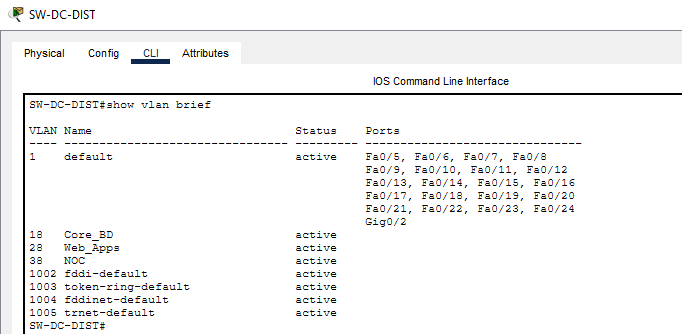  

**EtherChannel** (`show etherchannel summary`):

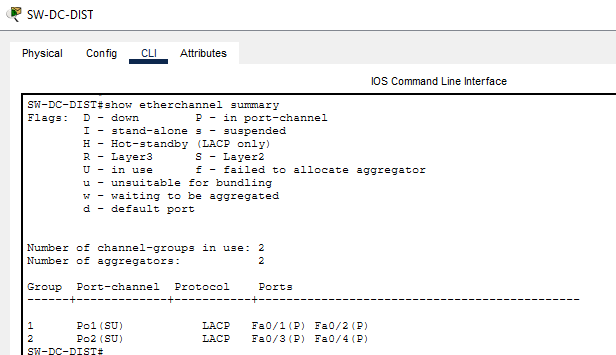


Ambos port-channels están en `SU` (Layer 2, en uso) con todos sus puertos agrupados (`P`).

**Rutas estáticas** (`show ip route` en R-Central2 y R-Central1):

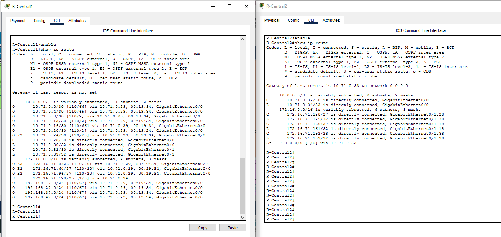


##  Redistribución de rutas

| Punto de redistribución | Dominios | Dirección |
|---|---|---|
| R-CORE2 | OSPF 7 ↔ EIGRP 7 | Bidireccional |
| R-Central1 | Estáticas → OSPF 7 | Estáticas hacia OSPF |

Las rutas de Norte (EIGRP) y del Data Center (estáticas) aparecen en el resto del backbone como rutas externas de OSPF (`O E2`), y las rutas OSPF aparecen en Norte como `D EX`.

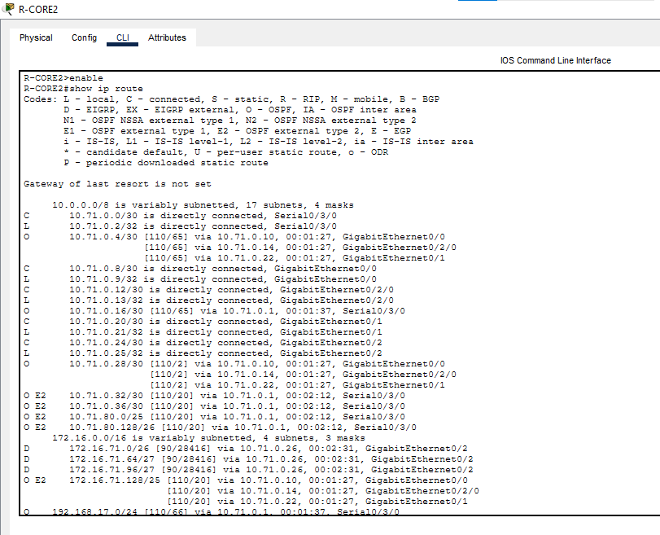
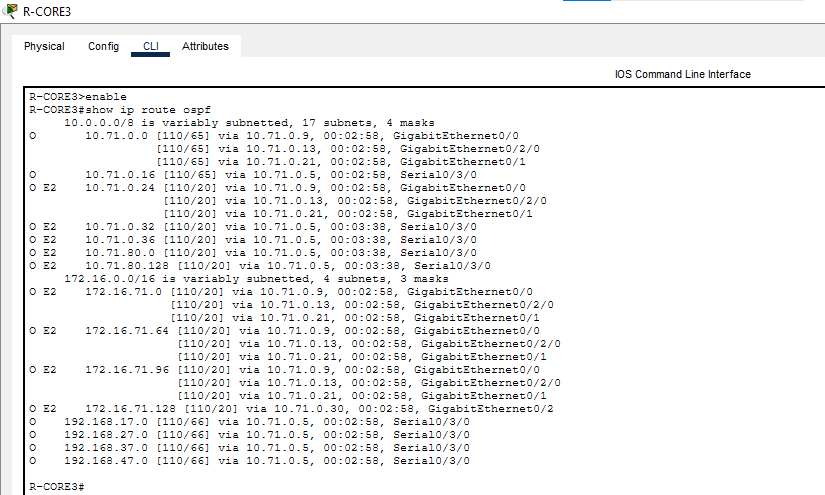

---

## conectividad

Todos los pings se hicieron desde el Command Prompt de un PC.

| # | Origen | Destino | Resultado |
|---|---|---|---|
| 1 | PC de cada zona de Norte y Data Center | Su gateway | Exitoso |
| 2 | PC de Analisis | PC de Auditoria | Exitoso |
| 3 | PC de Auditoria | PC de Legal | Exitoso |
| 4 | PC de Core_BD | PC de Web_Apps | Exitoso |
| 5 | PC de Web_Apps | PC de NOC | Exitoso |
| 6 | PC de Analisis (Norte) | PC de Core_BD (Data Center) | Exitoso |
| 7 | PC de Core_BD (Data Center) | PC de Analisis (Norte) | Exitoso |
| 8 | PC de Analisis (Norte) | PC de Occidente | Exitoso |
| 9 | PC de Core_BD (Data Center) | PC de Occidente | Exitoso |

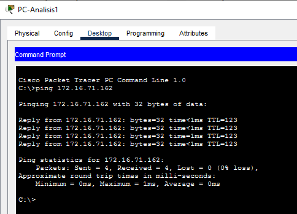
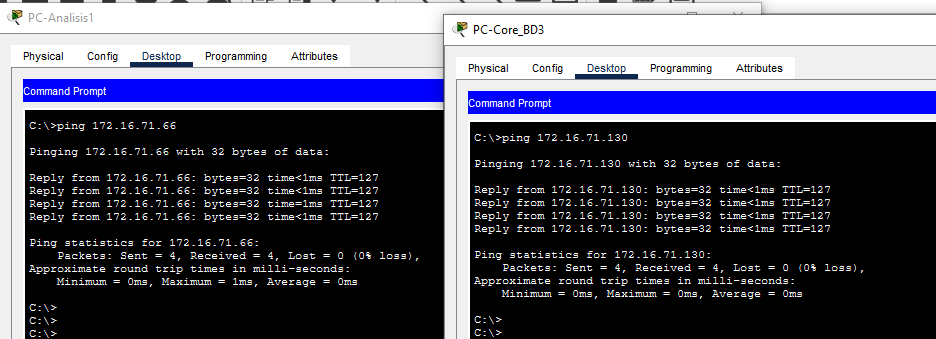

---

##  Pruebas de tolerancia a fallos

###  Caída de un enlace del triángulo (Rapid PVST+)

**Procedimiento:**
1. Se inició `ping -n 100 172.16.71.66` desde un PC de Analisis hacia un PC de Auditoria.
2. En SW-N-DIST se apagó la interfaz `Fa0/1` (enlace hacia SW-N-ACC1).
3. Se verificó con `show spanning-tree vlan 57` en SW-N-ACC1 que el tráfico pasó por SW-N-ACC2.
4. Se restauró el enlace con `no shutdown`.


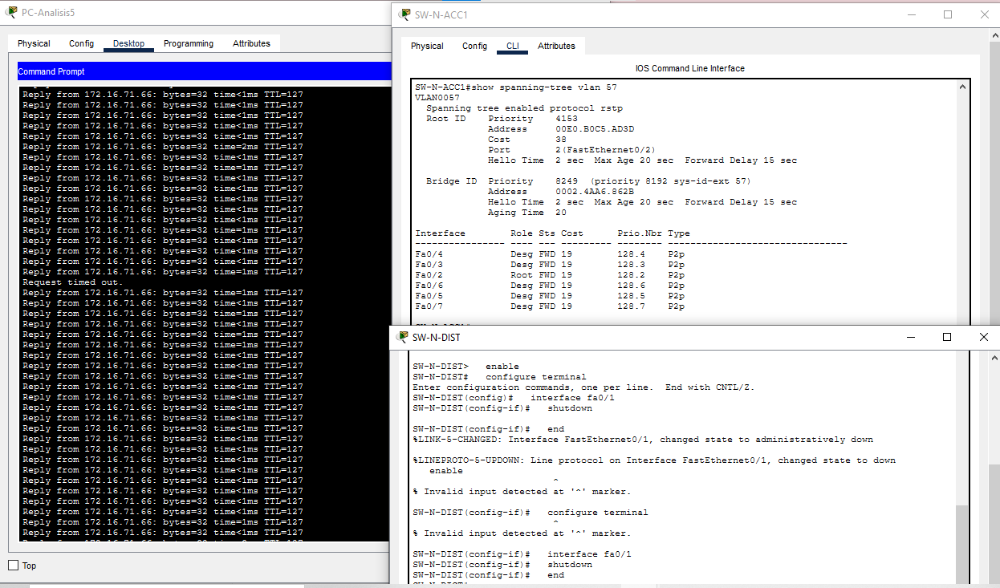

###  Caída de un miembro del EtherChannel

**Procedimiento:**
1. Se inició `ping -n 100 172.16.71.66` desde un PC de Core_BD hacia un PC de Web_Apps.
2. En SW-DC-DIST se apagó la interfaz `Fa0/1`, uno de los dos cables de Po1.
3. Se verificó con `show etherchannel summary` que Po1 seguía activo con Fa0/2.
4. Se restauró con `no shutdown`.


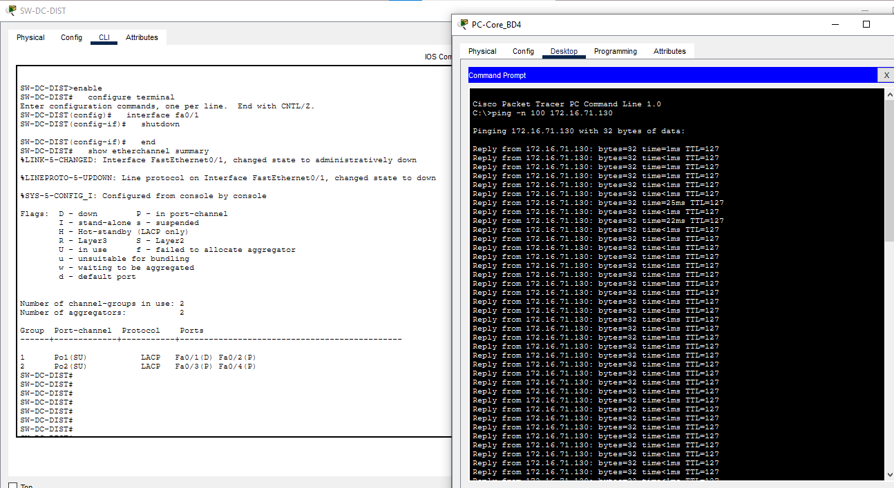

---

# BanTech GT: Sede Oriente y RIPv2

| Sede | Dominio de enrutamiento | Equipos | Dispositivos finales |
|---|---|---|---|
| Oriente (Centro Financiero Legado) | RIPv2 (redistribuido a OSPF 7 en R-CORE1) | MS1, MS2, SW-Oriente1, SW-Oriente2 | 10 PCs (5 por VLAN) |

Tecnologías aplicadas: VLANs con nombre, trunks 802.1Q, Rapid PVST+ con Root Bridge forzado, HSRP, enrutamiento inter-VLAN mediante interfaces SVI en switches multicapa, RIPv2 y redistribución RIPv2 ↔ OSPF.

---

## 8. Sede Oriente

### 8.1 Topología

**Descripción** Topología de la Sede Oriente. Los dos switches multicapa MS1 y MS2 (3560-24PS) forman la capa de distribución y están enlazados entre sí. Cada switch de acceso (SW-Oriente1 y SW-Oriente2, 2960-24TT) se conecta a ambos multicapa. MS1 y MS2 tienen también cuentan con un enlace de capa 3 cada uno hacia R-CORE1 del backbone.

Los rectángulos de color de la sede agrupan los equipos conectados a cada switch de acceso (SW-Oriente1 y SW-Oriente2). Ambos switches llevan equipos de las dos VLANs, y el rótulo de cada cuadro indica la VLAN con más equipos en ese switch: el cuadro amarillo dice VLAN 87 porque tiene tres PCs de Bóveda y dos de Plataforma, y la rosa dice VLAN 97 porque tiene tres PCs de Plataforma y dos de Bóveda. La pertenencia exacta de cada PC está en la tabla 8.5 y se verifica con `show vlan brief`.

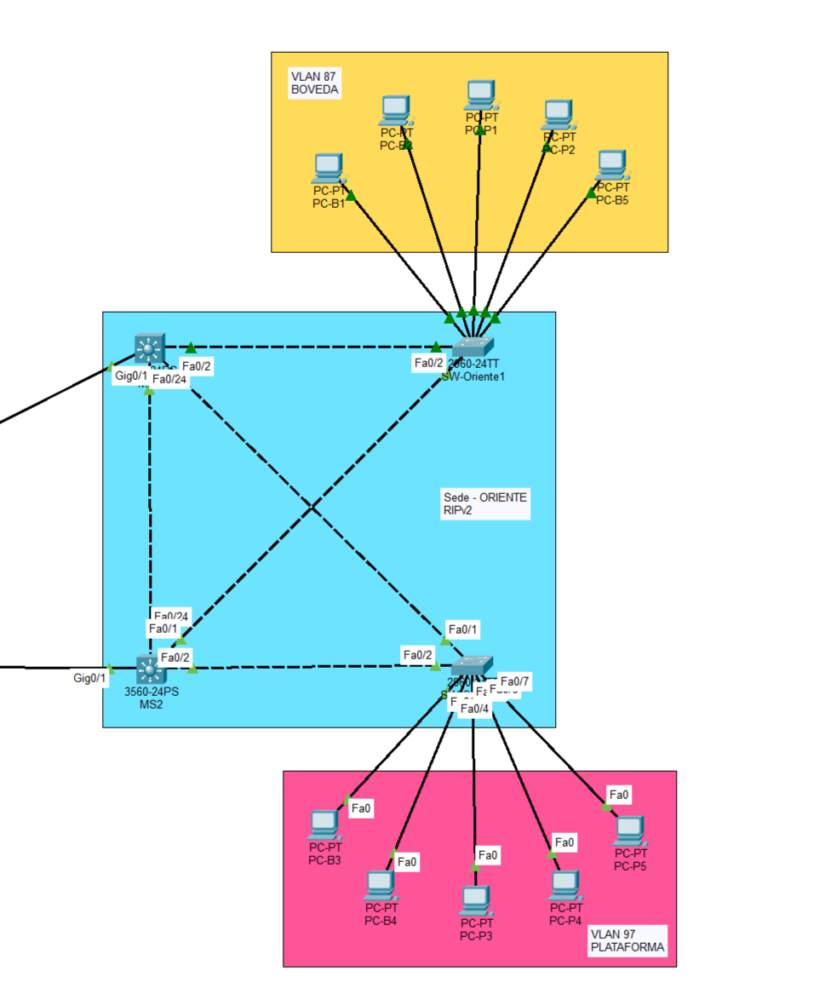

### 8.2 Contexto y necesidad operativa

La Sede Oriente pertenece a un banco que BanTech GT acababa de comprar y se trata como una sede crítica corporativa. El diseño del backbone ya incluyó para esta área dos switches multicapa, **MS1** y **MS2**. La necesidad operativa era alta disponibilidad del gateway: los usuarios finales no pueden perder conectividad hacia el núcleo del banco aunque MS1, el switch multicapa principal, sufra un corte de energía. La topología de acceso debía conectarse simultáneamente a MS1 y MS2.

### 8.3 Justificación de arquitectura

**Topología física:** Se usó un diseño de doble conexión. MS1 y MS2 están unidos por un trunk (`Fa0/24`) y cada uno se conecta con un trunk a cada switch de acceso. Los dos switches de acceso a la vez llevan los equipos de las dos VLANs. Así ningún switch de acceso depende de un solo multicapa y cada multicapa tiene su propio enlace de capa 3 hacia R-CORE1.

**Tolerancia a fallos:** Rapid PVST+ deja activo un solo camino por VLAN y mantiene el otro como alterno (`Altn BLK` en el puerto `Fa0/2` de cada switch de acceso). Si MS1 falla, ese puerto pasa a reenviar y el tráfico continúa por MS2. En capa 3, HSRP mantiene la misma dirección de gateway aunque cambie el equipo que la atiende, por lo que las PCs no necesitan reconfigurarse. La prueba de la sección 11 muestra la conmutación automática.

**Respuesta a la necesidad operativa:** MS1 y MS2 comparten las IP virtuales de gateway de las VLANs 87 y 97. MS1 es el gateway activo y MS2 queda en standby con `preempt`: si MS1 deja de responder, MS2 asume el rol, y cuando MS1 regresa recupera el rol activo.

**Elección del Root Bridge:** `MS1` es el Root Bridge de las VLANs 87 y 97 (prioridad 4096) y `MS2` es el Root secundario (prioridad 8192). Se eligió que MS1 fuera la raíz porque también es el gateway HSRP activo: el camino de capa 2 y el de capa 3 coinciden de modo que el tráfico de las PCs llega por el camino más corto al equipo que realmente enruta.

**Elección de HSRP:** El entorno de la sede es completamente Cisco y la rúbrica de calificación lista HSRP entre las tecnologías requeridas. VRRP se descartó porque su ventaja principal, la interoperabilidad con equipos de otros fabricantes, no hace falta en esta sede. El número de grupo coincide con el ID de la VLAN (87 y 97) para facilitar la lectura de la salida de `show standby brief`. Se configuraron los temporizadores `1 3` (hello de 1 segundo y hold de 3) para acortar la detección de una falla frente a los valores por defecto.

**Enrutamiento inter-VLAN mediante SVI:** Como la sede tiene switches multicapa, el inter-VLAN se resuelve con interfaces `Vlan87` y `Vlan97` en MS1 y MS2, sin router externo ni Router-on-a-Stick. El enrutamiento se hace en el hardware de los multicapa y se evita una dependencia adicional de un solo router.

**Elección de RIPv2:** Oriente es el dominio de red legada del backbone y corresponde a un banco adquirido (Centro Financiero Legado). Se detalla en la sección 9.

### 8.4 Inventario de dispositivos y cableado

| Dispositivo | Modelo | Función |
|---|---|---|
| MS1 | 3560-24PS (multicapa) | Switch principal, Root Bridge, HSRP activo, gateway de las VLANs 87 y 97 |
| MS2 | 3560-24PS (multicapa) | Switch de respaldo, Root secundario, HSRP standby |
| SW-Oriente1 | 2960-24TT | Switch de acceso, 2 VLANs |
| SW-Oriente2 | 2960-24TT | Switch de acceso, 2 VLANs |
| 10 PCs | PC-PT | 5 por VLAN: PC-B1 a PC-B5 (Bóveda) y PC-P1 a PC-P5 (Plataforma) |

| Extremo A | Extremo B | Cable | Función |
|---|---|---|---|
| MS1 Fa0/1 | SW-Oriente1 Fa0/1 | Cruzado | Trunk 802.1Q |
| MS2 Fa0/1 | SW-Oriente1 Fa0/2 | Cruzado | Trunk 802.1Q |
| MS1 Fa0/2 | SW-Oriente2 Fa0/1 | Cruzado | Trunk 802.1Q |
| MS2 Fa0/2 | SW-Oriente2 Fa0/2 | Cruzado | Trunk 802.1Q |
| MS1 Fa0/24 | MS2 Fa0/24 | Cruzado | Trunk 802.1Q entre multicapa |
| MS1 Gi0/1 | R-CORE1 Gi0/1 | Directo | Uplink de capa 3 (puerto enrutado) |
| MS2 Gi0/1 | R-CORE1 Gi0/2 | Directo | Uplink de capa 3 (puerto enrutado) |
| SW-Oriente1 Fa0/3-Fa0/7 | PCs | Directo | Puertos de acceso |
| SW-Oriente2 Fa0/3-Fa0/7 | PCs | Directo | Puertos de acceso |

### 8.5 Tabla de VLANs y asignación de equipos

| VLAN | Nombre | Área funcional | Hosts requeridos | Dispositivos | Red |
|---|---|---|---|---|---|
| 87 | Boveda | Operaciones de valores | 40 | 5 | 10.71.80.128/26 |
| 97 | Plataforma | Atención VIP | 60 | 5 | 10.71.80.0/25 |

| Switch | Puertos | VLAN | PCs |
|---|---|---|---|
| SW-Oriente1 | Fa0/3-4 | 87 Boveda | PC-B1, PC-B2 |
| SW-Oriente1 | Fa0/5-6 | 97 Plataforma | PC-P1, PC-P2 |
| SW-Oriente1 | Fa0/7 | 87 Boveda | PC-B5 |
| SW-Oriente2 | Fa0/3-4 | 87 Boveda | PC-B3, PC-B4 |
| SW-Oriente2 | Fa0/5-6 | 97 Plataforma | PC-P3, PC-P4 |
| SW-Oriente2 | Fa0/7 | 97 Plataforma | PC-P5 |


### 8.6 Subnetting (VLSM)

Bloque base: `10.71.80.0/24`. El segundo octeto corresponde al XX = 71. El bloque `10.71.0.0/24` se reservó para los enlaces punto a punto del backbone. Se asignó la subred de manera descendente.

| VLAN | Hosts req. | Hosts + gateways | Máscara | Red | Primer host | Último host | Broadcast | Gateway virtual |
|---|---|---|---|---|---|---|---|---|
| 97 Plataforma | 60 | 63 | /25 (255.255.255.128) | 10.71.80.0 | .1 | .126 | .127 | 10.71.80.1 |
| 87 Boveda | 40 | 43 | /26 (255.255.255.192) | 10.71.80.128 | .129 | .190 | .191 | 10.71.80.129 |

> **Nota:** Plataforma usa /25 y no /26 porque los 60 hosts más las direcciones de MS1, MS2 y la IP virtual de HSRP suman 63, y un /26 solo ofrece 62 direcciones útiles. Bóveda necesita 43 direcciones, que caben en un /26. Queda libre `10.71.80.192/26` para crecimiento.

### 8.7 Direcciones asignadas

**Dispositivos de red (interfaces SVI):**

| Interfaz | MS1 | MS2 | IP virtual HSRP |
|---|---|---|---|
| Vlan97 (Plataforma) | 10.71.80.2/25 | 10.71.80.3/25 | 10.71.80.1 |
| Vlan87 (Boveda) | 10.71.80.130/26 | 10.71.80.131/26 | 10.71.80.129 |

**Dispositivos finales:**

| PC | VLAN | IP | Máscara | Gateway |
|---|---|---|---|---|
| PC-B1 | 87 | 10.71.80.140 | 255.255.255.192 | 10.71.80.129 |
| PC-B2 | 87 | 10.71.80.141 | 255.255.255.192 | 10.71.80.129 |
| PC-B3 | 87 | 10.71.80.142 | 255.255.255.192 | 10.71.80.129 |
| PC-B4 | 87 | 10.71.80.143 | 255.255.255.192 | 10.71.80.129 |
| PC-B5 | 87 | 10.71.80.144 | 255.255.255.192 | 10.71.80.129 |
| PC-P1 | 97 | 10.71.80.10 | 255.255.255.128 | 10.71.80.1 |
| PC-P2 | 97 | 10.71.80.11 | 255.255.255.128 | 10.71.80.1 |
| PC-P3 | 97 | 10.71.80.12 | 255.255.255.128 | 10.71.80.1 |
| PC-P4 | 97 | 10.71.80.13 | 255.255.255.128 | 10.71.80.1 |
| PC-P5 | 97 | 10.71.80.14 | 255.255.255.128 | 10.71.80.1 |

### 8.8 Mapeo lógico

| Dispositivo | Rol | Trunks 802.1Q | Puertos de acceso / enrutados |
|---|---|---|---|
| MS1 | Switch principal / distribución, Root Bridge (VLAN 87 y 97), HSRP activo | Fa0/1 (SW-Oriente1), Fa0/2 (SW-Oriente2), Fa0/24 (MS2) | Gi0/1 enrutado hacia R-CORE1 |
| MS2 | Distribución secundario, Root secundario, HSRP standby | Fa0/1 (SW-Oriente1), Fa0/2 (SW-Oriente2), Fa0/24 (MS1) | Gi0/1 enrutado hacia R-CORE1 |
| SW-Oriente1 | Acceso | Fa0/1 (MS1), Fa0/2 (MS2) | Fa0/3-4 y Fa0/7 (VLAN 87), Fa0/5-6 (VLAN 97) |
| SW-Oriente2 | Acceso | Fa0/1 (MS1), Fa0/2 (MS2) | Fa0/3-4 (VLAN 87), Fa0/5-7 (VLAN 97) |

### 8.9 Configuraciones principales

**SW-Oriente1** (VLANs, trunks y puertos de acceso):
```
hostname SW-Oriente1
spanning-tree mode rapid-pvst
vlan 87
 name Boveda
vlan 97
 name Plataforma
interface range FastEthernet0/1 - 2
 switchport mode trunk
interface range FastEthernet0/3 - 4
 switchport mode access
 switchport access vlan 87
 spanning-tree portfast
interface range FastEthernet0/5 - 6
 switchport mode access
 switchport access vlan 97
 spanning-tree portfast
interface FastEthernet0/7
 switchport mode access
 switchport access vlan 87
 spanning-tree portfast
```

**SW-Oriente2** (igual que SW-Oriente1, con otro hostname y con el puerto Fa0/7 en la VLAN 97):
```
hostname SW-Oriente2
interface FastEthernet0/7
 switchport mode access
 switchport access vlan 97
 spanning-tree portfast
```

**MS1** (VLANs, Root Bridge, SVIs y HSRP activo):
```
hostname MS1
ip routing
vlan 87
 name Boveda
vlan 97
 name Plataforma
spanning-tree mode rapid-pvst
spanning-tree vlan 87,97 priority 4096
interface range FastEthernet0/1 - 2
 switchport trunk encapsulation dot1q
 switchport mode trunk
interface FastEthernet0/24
 switchport trunk encapsulation dot1q
 switchport mode trunk
interface Vlan97
 ip address 10.71.80.2 255.255.255.128
 standby 97 ip 10.71.80.1
 standby 97 priority 110
 standby 97 preempt
 standby 97 timers 1 3
interface Vlan87
 ip address 10.71.80.130 255.255.255.192
 standby 87 ip 10.71.80.129
 standby 87 priority 110
 standby 87 preempt
 standby 87 timers 1 3
```

**MS2** (igual que MS1, con Root secundario y HSRP standby):
```
hostname MS2
spanning-tree vlan 87,97 priority 8192
interface Vlan97
 ip address 10.71.80.3 255.255.255.128
 standby 97 ip 10.71.80.1
 standby 97 priority 100
 standby 97 preempt
 standby 97 timers 1 3
interface Vlan87
 ip address 10.71.80.131 255.255.255.192
 standby 87 ip 10.71.80.129
 standby 87 priority 100
 standby 87 preempt
 standby 87 timers 1 3
```
> **Nora:** El resto de la configuración de MS2, es decir `ip routing`, las VLANs, `rapid-pvst` y los trunks, es idéntico al de MS1.

### 8.10 Evidencias de VLANs, trunks, Rapid PVST+ y HSRP

**VLANs** (`show vlan brief` en SW-Oriente1):

En SW-Oriente1, la VLAN 87 `Boveda` contiene Fa0/3, Fa0/4 y Fa0/7, y la VLAN 97 `Plataforma` contiene Fa0/5 y Fa0/6. Ambas VLANs aparecen con nombre y en estado activo.

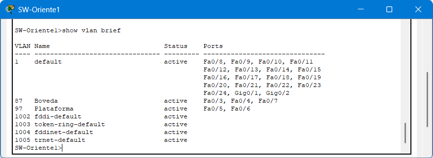

**Trunks** (`show interfaces trunk` en SW-Oriente1):
Fa0/1 (hacia MS1) y Fa0/2 (hacia MS2) están en modo trunk con encapsulación 802.1Q. Las VLANs 1, 87 y 97 están activas en ambos. En estado de reenvío de spanning-tree, Fa0/1 lleva las VLANs 1, 87 y 97, mientras que Fa0/2 solo lleva la VLAN 1: es el camino alterno, bloqueado por Rapid PVST+ para las VLANs 87 y 97.

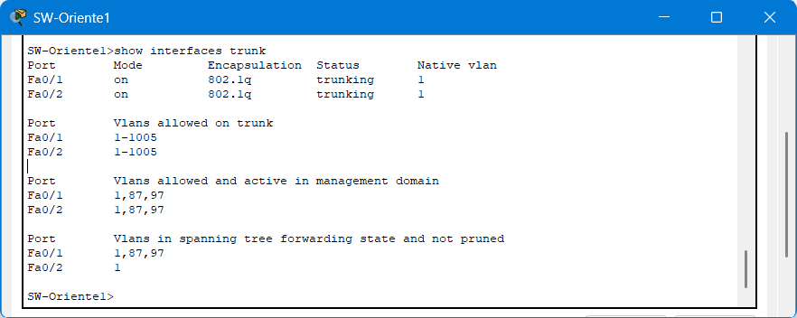

**Rapid PVST+ y Root Bridge** (`show spanning-tree vlan 97`; salida de consola, extracto):
MS1 es el Root Bridge de la VLAN 97 (prioridad 4096 más el ID de VLAN, 4193) y todos sus puertos están en reenvío. En SW-Oriente1, Fa0/1 (hacia MS1) es el puerto raíz y Fa0/2 (hacia MS2) es el alterno bloqueado.

```
MS1#show spanning-tree vlan 97
VLAN0097
  Spanning tree enabled protocol rstp
  Root ID    Priority    4193
             Address     00E0.A3A9.8879
             This bridge is the root

Interface        Role Sts Cost      Prio.Nbr Type
---------------- ---- --- --------- -------- ----
Fa0/24           Desg FWD 19        128.24   P2p
Fa0/1            Desg FWD 19        128.1    P2p
Fa0/2            Desg FWD 19        128.2    P2p
```

```
SW-Oriente1>show spanning-tree vlan 97
VLAN0097
  Spanning tree enabled protocol rstp
  Root ID    Priority    4193
             Address     00E0.A3A9.8879
             Cost        19
             Port        1(FastEthernet0/1)

Interface        Role Sts Cost      Prio.Nbr Type
---------------- ---- --- --------- -------- ----
Fa0/2            Altn BLK 19        128.2    P2p
Fa0/5            Desg FWD 19        128.5    P2p
Fa0/6            Desg FWD 19        128.6    P2p
Fa0/1            Root FWD 19        128.1    P2p
```
**HSRP en MS1** (`show standby brief`):
MS1 es el gateway activo (Active) de los grupos 87 y 97, con prioridad 110 y `preempt` habilitado (P). El standby es MS2: 10.71.80.131 para la VLAN 87 y 10.71.80.3 para la VLAN 97. Las IP virtuales son 10.71.80.129 y 10.71.80.1.*

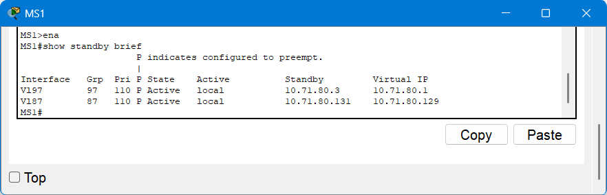

**HSRP en MS2** (`show standby brief`):
Descripción: MS2 está en estado Standby en los dos grupos, con prioridad 100. El gateway activo que reconoce es MS1 (10.71.80.130 para la VLAN 87 y 10.71.80.2 para la VLAN 97).

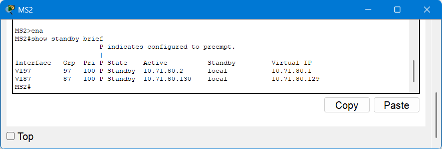

### 8.11 Enrutamiento inter-VLAN

Las SVIs `Vlan87` y `Vlan97` de MS1 y MS2 enrutan entre las dos VLANs de Oriente. La prueba se hizo desde PC-B1 (VLAN 87) hacia PC-P1 (VLAN 97).

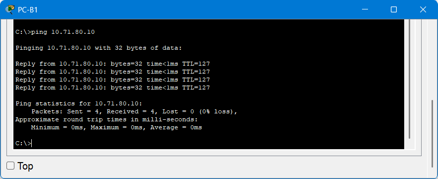

Ping de PC-B1 (10.71.80.140) a PC-P1 (10.71.80.10), 4 paquetes enviados y 4 recibidos, 0 % de pérdida. El TTL de 127 indica que el paquete atravesó un salto de capa 3, el gateway de MS1 o MS2.*

---

## 9. Integración con el backbone: RIPv2 y redistribución

### 9.1 Enlaces hacia el núcleo

Cada multicapa tiene su propio enlace de capa 3 hacia el backbone. Los dos van hacia **R-CORE1**. Se asignaron dos subredes **/30** adicionales a las seis del backbone.

| Red | Primer extremo | Segundo extremo | Medio |
|---|---|---|---|
| 10.71.0.32/30 | R-CORE1 G0/1: 10.71.0.33 | MS1 G0/1: 10.71.0.34 | Ethernet |
| 10.71.0.36/30 | R-CORE1 G0/2: 10.71.0.37 | MS2 G0/1: 10.71.0.38 | Ethernet |

En MS1 y MS2 la interfaz Gi0/1 se configuró como puerto enrutado (`no switchport`), no como parte de una VLAN.

### 9.2 Elección de RIPv2

Se pide un dominio de red legada con RIPv2, y Oriente corresponde al banco adquirido por lo que se le asignó este protocolo. Se usó la versión 2 y no la 1 porque RIPv2 transporta la máscara de cada ruta (soporta VLSM): Oriente usa un /25 y un /26 dentro del mismo bloque, y los enlaces del backbautone son /30. Se deshabilitó el resumen omático (`no auto-summary`) porque las redes 10.71.0.x y 10.71.80.x pertenecen a la misma clase A y se resumirían como 10.0.0.0/8. Las SVIs se declararon pasivas para no enviar actualizaciones hacia los PCs.

### 9.3 Configuración

**R-CORE1** (backbone; configuración agregada por este integrante: uplinks, RIPv2 y redistribución):
```
interface GigabitEthernet0/1
 description Enlace a MS1 Oriente
 ip address 10.71.0.33 255.255.255.252
 no shutdown
interface GigabitEthernet0/2
 description Enlace a MS2 Oriente
 ip address 10.71.0.37 255.255.255.252
 no shutdown
router rip
 version 2
 no auto-summary
 passive-interface default
 no passive-interface GigabitEthernet0/1
 no passive-interface GigabitEthernet0/2
 network 10.0.0.0
 redistribute ospf 7 metric 2
router ospf 7
 redistribute rip subnets
```

**MS1** (uplink y RIPv2):
```
interface GigabitEthernet0/1
 description Uplink a R-CORE1
 no switchport
 ip address 10.71.0.34 255.255.255.252
 no shutdown
router rip
 version 2
 no auto-summary
 passive-interface Vlan87
 passive-interface Vlan97
 network 10.0.0.0
```

**MS2** (uplink y RIPv2):
```
interface GigabitEthernet0/1
 description Uplink a R-CORE1
 no switchport
 ip address 10.71.0.38 255.255.255.252
 no shutdown
router rip
 version 2
 no auto-summary
 passive-interface Vlan87
 passive-interface Vlan97
 network 10.0.0.0
```

### 9.4 Redistribución de rutas

R-CORE1 es el punto donde se unen RIPv2 y OSPF 7, y redistribuye en los dos sentidos:

| Punto de redistribución | Dominios | Dirección | Configuración |
|---|---|---|---|
| R-CORE1 | RIPv2 ↔ OSPF 7 | Bidireccional | `redistribute ospf 7 metric 2` en RIP y `redistribute rip subnets` en OSPF |

Con este punto, el backbone cuenta con tres puntos de redistribución: R-CORE2 (OSPF ↔ EIGRP), R-Central1 (estáticas → OSPF) y R-CORE1 (RIPv2 ↔ OSPF).

Las rutas de Oriente aparecen en el resto del backbone como rutas externas de OSPF (`O E2`), y las rutas de OSPF, EIGRP y estáticas llegan a MS1 y MS2 como rutas RIP (`R`):

```
R-CORE2#show ip route
O E2    10.71.80.0/25 [110/20] via 10.71.0.1, 00:00:56, Serial0/3/0
O E2    10.71.80.128/26 [110/20] via 10.71.0.1, 00:00:56, Serial0/3/0
```

```
MS1#show ip route rip
R       172.16.71.128/25 [120/2] via 10.71.0.33, 00:00:23, GigabitEthernet0/1
R       192.168.17.0/24 [120/2] via 10.71.0.33, 00:00:23, GigabitEthernet0/1
```

### 9.5 Evidencias de RIPv2 y redistribución

**RIPv2 en MS1** (`show ip protocols` y `show ip route rip`):
MS1 ejecuta RIP versión 2 con resumen automático deshabilitado, anuncia la red 10.0.0.0, tiene pasivas las interfaces Vlan87 y Vlan97 y aprende rutas de R-CORE1 (10.71.0.33). La tabla muestra las rutas RIP hacia el backbone (10.71.0.x), Norte (172.16.71.0/26, .64/27 y .96/27), el Data Center (172.16.71.128/25) y Occidente (192.168.17, 27, 37 y 47.0/24).

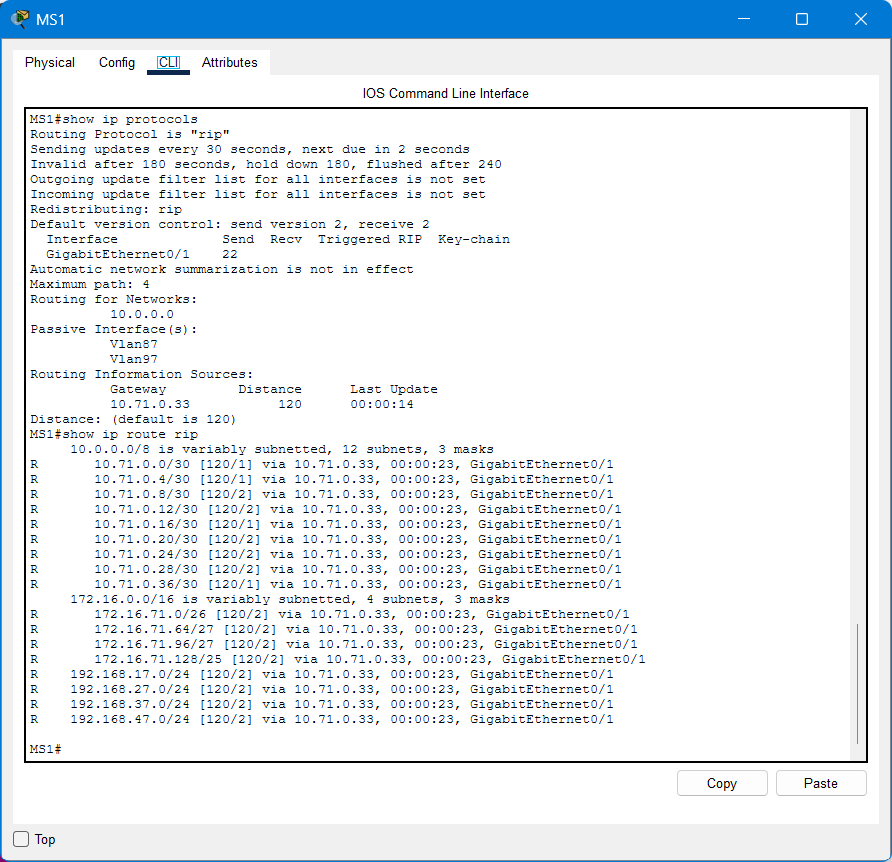

**Redistribución en R-CORE1** (`show ip protocols`):
R-CORE1 ejecuta RIP y OSPF 7. En RIP aparece `Redistributing: rip, ospf 7` y las interfaces Gi0/1 y Gi0/2 activas, con MS1 (10.71.0.34) y MS2 (10.71.0.38) como fuentes de información. En OSPF 7 aparece como `autonomous system boundary router` que redistribuye rutas externas desde RIP.

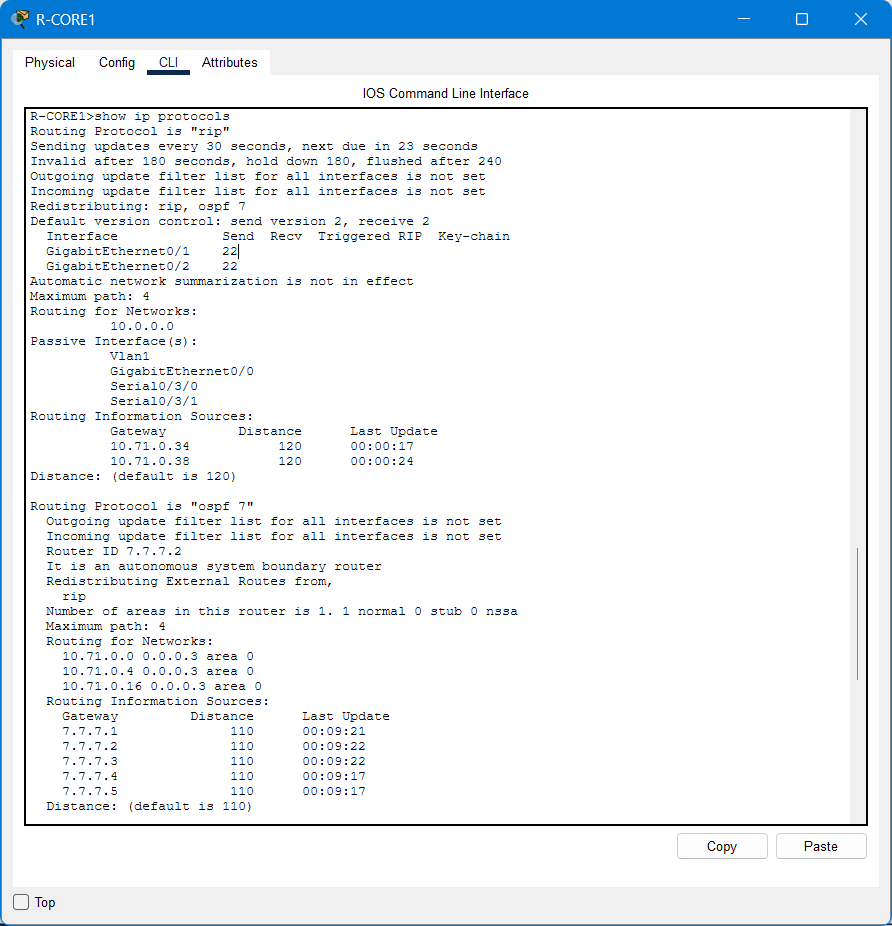

**Redistribución en R-CORE1** (`show ip route`):
Tabla de rutas de R-CORE1. Las redes de Oriente (10.71.80.0/25 y 10.71.80.128/26) aparecen como rutas RIP por los dos uplinks (10.71.0.34 y 10.71.0.38), mientras que las redes de Norte, Data Center y Occidente se aprenden por OSPF.

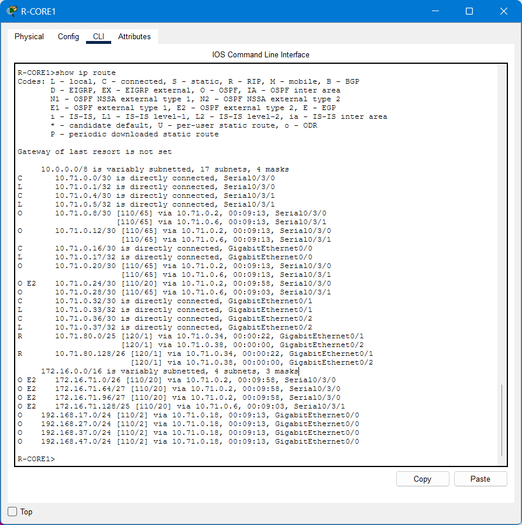

**Convergencia de rutas en MS1 y MS2** (`show ip route`):
Tablas de rutas de MS1 (izquierda) y MS2 (derecha). Ambos conocen como conectadas las redes de Oriente y aprenden por RIP, desde R-CORE1, las demás redes del backbone, Norte, Data Center y Occidente. Cada multicapa usa su propio uplink (10.71.0.33 para MS1 y 10.71.0.37 para MS2).

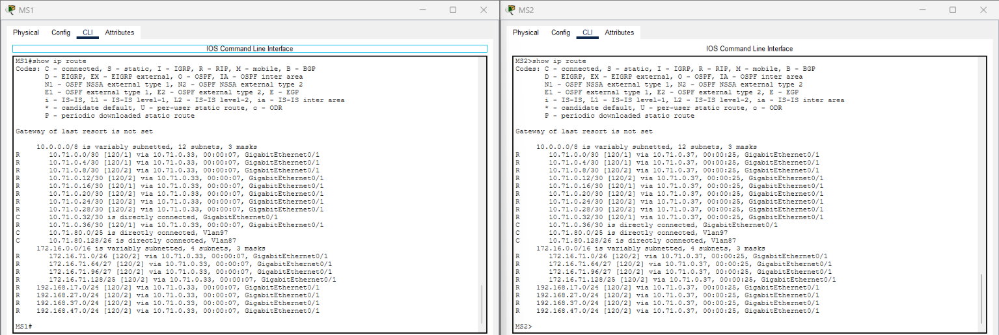

**Estado final de R-CORE1 en convergencia:**
`show ip route` de R-CORE1 con la red ya estable: 17 subredes en 10.0.0.0/8, 4 subredes en 172.16.0.0/16 y las cuatro redes 192.168.x7.0/24 de Occidente, además de las rutas RIP de Oriente por 10.71.0.34 y 10.71.0.38.

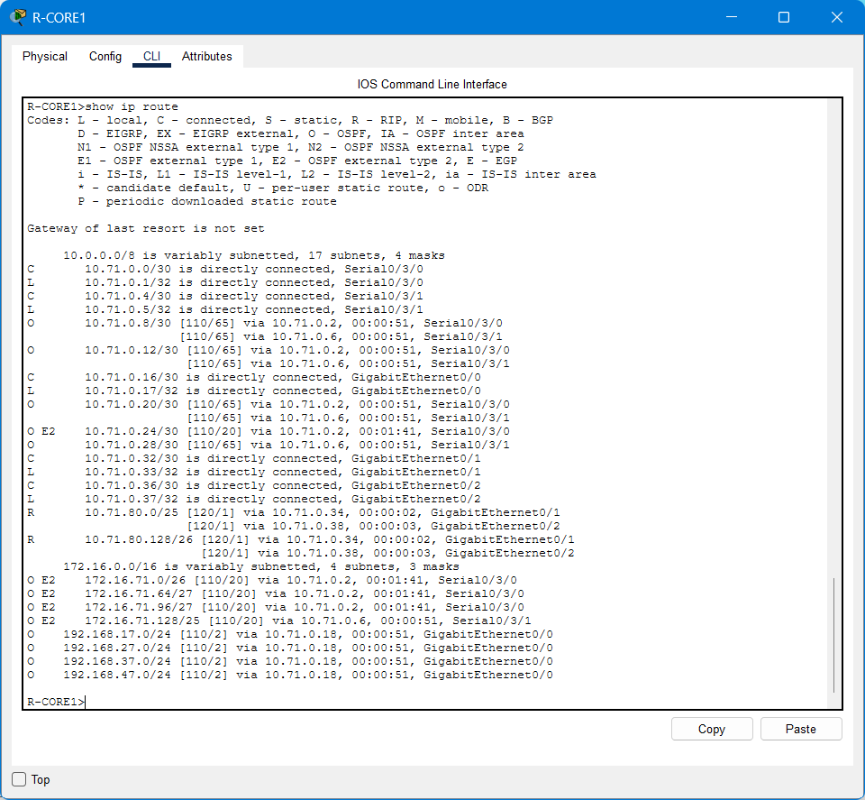

---

## 10. Pruebas de conectividad de Oriente

Todos los pings se hicieron desde el Command Prompt de un PC.

| # | Origen | Destino | IP de destino | Resultado | TTL |
|---|---|---|---|---|---|
| 1 | PC-B1 | PC-B3 (misma VLAN, otro switch) | 10.71.80.142 | Exitoso | 128 |
| 2 | PC-P1 | PC-P3 (misma VLAN, otro switch) | 10.71.80.12 | Exitoso | 128 |
| 3 | PC-B1 | Gateway virtual de Bóveda | 10.71.80.129 | Exitoso | 255 |
| 4 | PC-P1 | Gateway virtual de Plataforma | 10.71.80.1 | Exitoso | 255 |
| 5 | PC-B1 | PC-P1 (inter-VLAN) | 10.71.80.10 | Exitoso | 127 |
| 6 | PC-P5 | PC-B1 (inter-VLAN) | 10.71.80.140 | Exitoso | 127 |
| 7 | PC-B1 | CAJA_PC1 (Occidente) | 192.168.17.11 | Exitoso | 125 |
| 8 | PC-B1 | PC-Analisis1 (Norte) | 172.16.71.2 | Exitoso | 124 |
| 9 | PC-B1 | PC-Web_Apps1 (Data Center) | 172.16.71.130 | Exitoso | 123 |
| 10 | PC-B1 | PC-NOC1 (Data Center) | 172.16.71.194 | Exitoso | 123 |
| 11 | CAJA_PC1 (Occidente) | PC-B1 | 10.71.80.140 | Exitoso | 125 |
| 12 | PC-Analisis1 (Norte) | PC-B1 | 10.71.80.140 | Exitoso | 124 |
| 13 | PC-Web_Apps1 (Data Center) | PC-B1 | 10.71.80.140 | Exitoso | 123 |


**Pings de PC-B1 hacia las otras sedes:**
Desde PC-B1 se hizo ping a CAJA_PC1 de Occidente (192.168.17.11), a PC-Analisis1 de Norte (172.16.71.2), a PC-Web_Apps1 (172.16.71.130) y a PC-NOC1 (172.16.71.194) del Data Center. Los cuatro terminaron con 4 paquetes recibidos y 0 % de pérdida, con TTL 125, 124, 123 y 123 respectivamente.

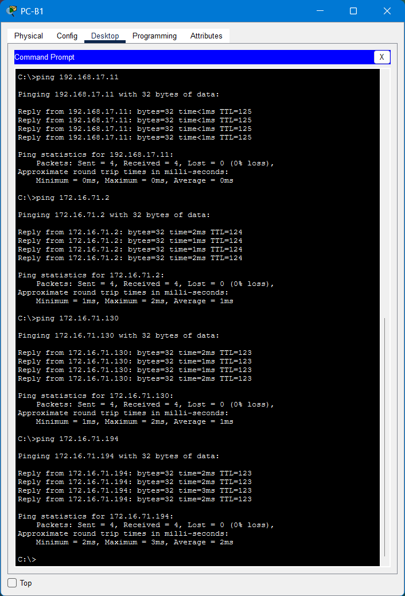

---

## 11. Prueba de tolerancia a fallos de HSRP

### 11.1 Procedimiento

Se simuló el corte de energía de MS1 que describe el enunciado, apagando todos sus enlaces:

1. Se inició un ping continuo desde PC-B1 hacia CAJA_PC1 de Occidente: `ping -t 192.168.17.11`.
2. En **MS1** se apagaron `Fa0/1`, `Fa0/2` (hacia los switches de acceso), `Fa0/24` (hacia MS2) y `Gi0/1` (uplink hacia R-CORE1) con `shutdown`.
3. Se esperó a que el ping se recuperara y se verificó `show standby brief` en MS2.
4. En R-CORE1 se verificó con `show ip route rip` que las rutas de Oriente quedaron solo por el uplink de MS2 (10.71.0.38).
5. Se detuvo el ping y se revisaron las estadísticas.

### 11.2 Resultado

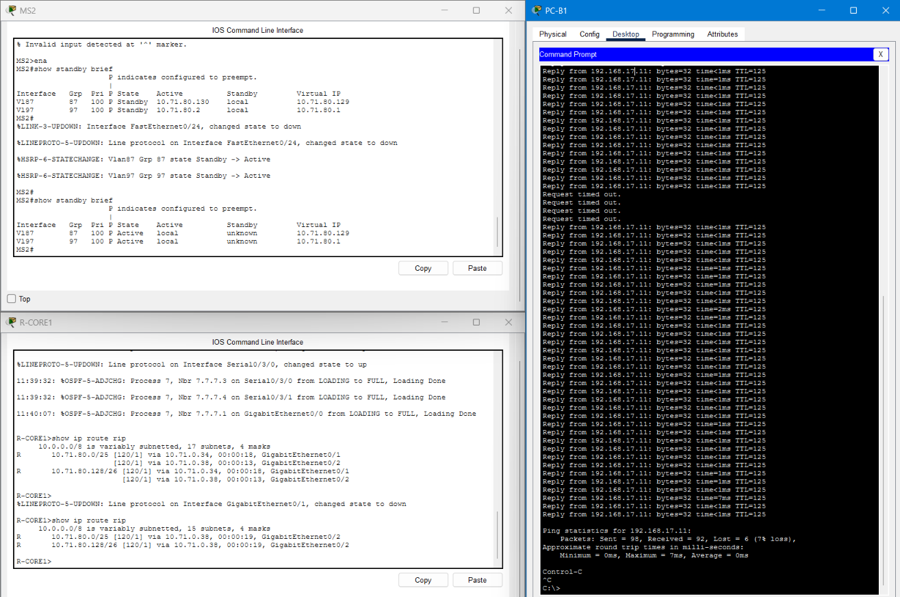

En MS2, `show standby brief` pasa de Standby a Active en los grupos 87 y 97 cuando cae el enlace con MS1, con el standby en `unknown`. En R-CORE1, `show ip route rip` muestra primero las rutas de Oriente por los dos uplinks (10.71.0.34 y 10.71.0.38) y, después de apagar el enlace de MS1, solo por 10.71.0.38. En PC-B1, el ping continuo muestra respuestas, una breve racha de cuatro tiempos de espera agotados durante la conmutación y de nuevo respuestas, con estadísticas de 98 paquetes enviados, 92 recibidos y 6 perdidos (7 %).

| Elemento | Antes de la falla | Después de la falla |
|---|---|---|
| Gateway HSRP activo (grupos 87 y 97) | MS1 | MS2 |
| Rutas de Oriente en R-CORE1 | Por 10.71.0.34 (MS1) y 10.71.0.38 (MS2) | Solo por 10.71.0.38 (MS2) |
| Ping continuo de PC-B1 | Respuestas | 4 pérdidas consecutivas y recuperación automática |

La comunicación se restableció sin ninguna intervención manual y sin reconfigurar los PCs. En una prueba previa, al restaurar los enlaces de MS1, este recuperó el rol Active gracias a `preempt` y MS2 volvió a Standby.

---